# СОДЕРЖАНИЕ

{{toc}}

# 1 Лабораторная работа № 1. Статический анализ кода и юнит-тестирование веб-приложения

## 1.1 Цель работы

1. Освоить инструменты статического анализа JavaScript-кода.
2. Научиться настраивать ESLint и Prettier для обеспечения единого стиля кода.
3. Изучить методологию юнит-тестирования с использованием Vitest.
4. Получить практические навыки написания тестов для функций и модулей.
5. Понять принципы Test-Driven Development (TDD).

## 1.2 Ход работы

### 1.2.1 Проект и инструменты

Проект создан командой `npm init -y`, зависимости установлены командой `npm install --save-dev eslint @eslint/js prettier vitest @vitest/coverage-v8`. Использованы версии ESLint 10.15, Prettier 3.10, Vitest 5.1, Node.js 22. Структура проекта:

```text
lab1
├── eslint.config.js     правила ESLint
├── .prettierrc.json     правила форматирования
├── vitest.config.js     настройки покрытия и пороги 80 %
├── package.json         скрипты test, test:coverage, lint, format
└── src
    ├── cart.js          модуль корзины (calculateTotal, applyDiscount)
    ├── cart.test.js
    ├── format.js        задание 1 (formatCurrency)
    ├── format.test.js
    ├── email.js         задание 3 (validateEmail, TDD)
    └── email.test.js
```

### 1.2.2 ESLint и Prettier

Конфигурация ESLint взята из задания: рекомендуемый набор правил плюс `no-unused-vars`, `no-console`, `eqeqeq` и `prefer-const`. Проверка файла с типичными ошибками приведена в листинге @lst:l1-badjs.

Листинг: {#l1-badjs} Проверка файла с ошибками командой npx eslint examples/bad.js

```text
examples/bad.js
  2:5   error    'total' is never reassigned. Use 'const' instead  prefer-const
  3:7   error    'unused' is assigned a value but never used       no-unused-vars
  6:13  error    Expected '===' and instead saw '=='               eqeqeq
  7:5   error    'console' is not defined                          no-undef
  7:5   warning  Unexpected console statement                      no-console

✖ 5 problems (4 errors, 1 warning)
```

ESLint нашел все четыре нарушения из настроенных правил. Пятое сообщение `no-undef` дает рекомендуемый набор правил. Для `src/` команда `npm run lint` выдает 0 проблем.

Prettier настроен на одинарные кавычки и строку до 100 символов. Команда `npx prettier --check src/` подтверждает, что все файлы отформатированы.

### 1.2.3 Модуль корзины и тесты

Модуль `src/cart.js` и тесты `src/cart.test.js` написаны по заданию. Первый запуск показал 6 пройденных тестов и покрытие ветвей 91,7 %: не была проверена ветка `item.quantity || 1`, когда количество не указано. Я добавил тест на этот случай, и покрытие стало полным (листинг @lst:l1-cart).

Листинг: {#l1-cart} Добавленный тест для товара без количества

```javascript
it('should use quantity 1 when it is not set', () => {
  expect(calculateTotal([{ price: 40 }, { price: 10, quantity: 3 }])).toBe(70);
});
```

### 1.2.4 Запуск тестов и анализ покрытия

В `vitest.config.js` заданы пороги покрытия: 80 % по строкам и ветвям. Итоговый результат по всему проекту приведен в листинге @lst:l1-cov и на рисунке @fig:l1-cov.

Листинг: {#l1-cov} Итог команды npm run test:coverage

```text
 Test Files  3 passed (3)
      Tests  35 passed (35)

=============================== Coverage summary ===============================
Statements   : 100% ( 40/40 )
Branches     : 100% ( 34/34 )
Functions    : 100% ( 6/6 )
Lines        : 100% ( 33/33 )
```

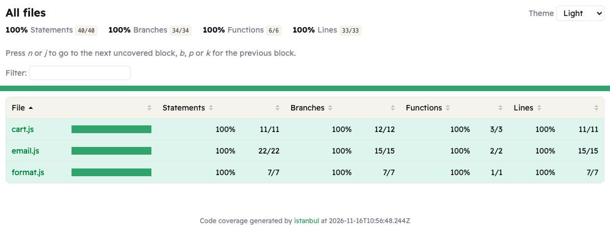{#l1-cov width=16cm}

## 1.3 Задания для самостоятельного выполнения

### 1.3.1 Задание 1. Функция formatCurrency

**Текст задания.** Добавьте функцию `formatCurrency(amount, currency)` и напишите для нее тесты (минимум 5 тест-кейсов).

Функция форматирует сумму через `Intl.NumberFormat` с русской локалью: два знака после запятой, разделение разрядов и знак валюты. Поддерживаются рубли, доллары и евро, по умолчанию рубли. На некорректную сумму (`NaN`, `Infinity`, строку) и неизвестную валюту функция бросает ошибку (листинг @lst:l1-fmt).

Листинг: {#l1-fmt} Функция formatCurrency (src/format.js)

```javascript
const SUPPORTED = ['RUB', 'USD', 'EUR'];

export const formatCurrency = (amount, currency = 'RUB') => {
  if (typeof amount !== 'number' || !Number.isFinite(amount)) {
    throw new Error('Amount must be a finite number');
  }
  if (!SUPPORTED.includes(currency)) {
    throw new Error(`Unsupported currency: ${currency}`);
  }
  return new Intl.NumberFormat('ru-RU', {
    style: 'currency', currency,
    minimumFractionDigits: 2, maximumFractionDigits: 2,
  }).format(amount);
};
```

Написано 9 тест-кейсов (таблица @tbl:l1-fmt). `Intl` отделяет разряды и знак валюты неразрывным пробелом U+00A0, поэтому ожидаемые строки в тестах собраны через константу `NBSP`.

Таблица: {#l1-fmt} Тест-кейсы formatCurrency

| № | Проверка | Вход | Ожидаемый результат |
|---|---|---|---|
| 1 | Рубли, разряды и копейки | 1234.5, RUB | 1 234,50 ₽ |
| 2 | Валюта по умолчанию | 100 | 100,00 ₽ |
| 3 | Доллары и евро | 99.9, USD / EUR | 99,90 $ / 99,90 € |
| 4 | Ноль | 0, RUB | 0,00 ₽ |
| 5 | Отрицательная сумма | -250, RUB | -250,00 ₽ |
| 6 | Округление до копеек | 10.456, RUB | 10,46 ₽ |
| 7 | Миллионы | 1000000, RUB | 1 000 000,00 ₽ |
| 8 | Некорректная сумма | '100', NaN, Infinity | ошибка |
| 9 | Неподдерживаемая валюта | 10, GBP | ошибка |

Все 9 тестов проходят, покрытие файла 100 %.

### 1.3.2 Задание 2. GitHub Actions

**Текст задания.** Настройте GitHub Actions для автоматического запуска тестов при каждом push.

Все лабораторные лежат в одном репозитории, поэтому workflow запускается только при изменениях в папке `lab1` (фильтр `paths`). Задача выполняет линтер, проверку форматирования и тесты с покрытием, а HTML-отчет о покрытии сохраняет как артефакт сборки (листинг @lst:l1-ci).

Листинг: {#l1-ci} Файл .github/workflows/lab1-tests.yml

```yaml
name: ЛР1 Unit tests
on:
  push:
    paths: ['lab1/**', '.github/workflows/lab1-tests.yml']
  pull_request:
    paths: ['lab1/**']
jobs:
  test:
    runs-on: ubuntu-latest
    defaults:
      run:
        working-directory: lab1
    steps:
      - uses: actions/checkout@v4
      - uses: actions/setup-node@v4
        with:
          node-version: 22
          cache: npm
          cache-dependency-path: lab1/package-lock.json
      - run: npm ci
      - run: npm run lint
      - run: npm run format:check
      - run: npm run test:coverage
      - uses: actions/upload-artifact@v4
        with:
          name: lab1-coverage
          path: lab1/coverage/
```

Первый же запуск в GitHub Actions прошел успешно за 14 секунд: линтер, проверка форматирования и 35 тестов с покрытием, отчет о покрытии сохранен как артефакт (рисунок @fig:l1-ci). Репозиторий: https://github.com/popuguy4ik/quality-labs.

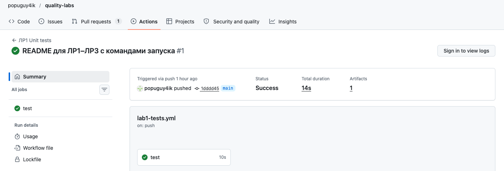{#l1-ci width=16.5cm}


### 1.3.3 Задание 3. validateEmail через TDD

**Текст задания.** Реализуйте функцию `validateEmail` через TDD: сначала напишите тесты, потом реализацию.

Работа шла по циклу «красный, зеленый, рефакторинг», каждый этап зафиксирован отдельным коммитом.

**Красный.** Сначала я описал требования тестами: 4 корректных адреса, обрезка пробелов, 11 некорректных случаев (нет `@`, два `@`, пустые части, домен без точки, однобуквенная зона, пробел внутри, точка в начале, две точки подряд, дефис в начале метки домена), слишком длинная локальная часть и значения не строкового типа. Вместо реализации стояла заглушка, которая бросает ошибку, поэтому все 18 тестов упали (листинг @lst:l1-red).

Листинг: {#l1-red} Первый запуск: тесты без реализации

```text
     × accepts valid address user@example.com 2ms
     × accepts valid address ilya.gugu@mail.ru 0ms
     × trims spaces around the address 0ms
     ...
 Test Files  1 failed (1)
      Tests  18 failed (18)
```

**Зеленый.** Затем написана минимальная реализация, которой хватает, чтобы пройти все тесты (листинг @lst:l1-email). Адрес делится по `@` ровно на две части, локальная часть и каждая метка домена проверяются регулярными выражениями, зона должна состоять минимум из двух букв.

Листинг: {#l1-email} Реализация validateEmail (src/email.js)

```javascript
const LOCAL = /^[A-Za-z0-9_%+-]+(\.[A-Za-z0-9_%+-]+)*$/;
const LABEL = /^[A-Za-z0-9]([A-Za-z0-9-]*[A-Za-z0-9])?$/;
const TLD = /^[A-Za-z]{2,}$/;

export const validateEmail = (value) => {
  if (typeof value !== 'string') return false;
  const email = value.trim();
  if (email.length > 254) return false;

  const parts = email.split('@');
  if (parts.length !== 2) return false;
  const [local, domain] = parts;

  if (local.length === 0 || local.length > 64 || !LOCAL.test(local)) return false;

  const labels = domain.split('.');
  if (labels.length < 2) return false;
  if (!labels.every((label) => LABEL.test(label))) return false;
  return TLD.test(labels[labels.length - 1]);
};
```

Все 18 тестов прошли.

**Рефакторинг.** Отчет о покрытии показал, что ветка с ограничением общей длины адреса (254 символа) ни одним тестом не проверяется. Я добавил тест на адрес длиной 259 символов, и покрытие файла стало 100 %. В итоге в проекте 35 тестов, все проходят (листинг @lst:l1-cov).

История коммитов показывает порядок работы:

```text
ЛР1, задание 3 (TDD, green + refactor): реализация validateEmail
ЛР1, задание 3 (TDD, red): тесты validateEmail без реализации
ЛР1, задание 1: formatCurrency и 9 тестов
ЛР1: проект, ESLint, Prettier, модуль корзины и тесты
```

## 1.4 Вывод

В работе настроены ESLint и Prettier, написаны юнит-тесты на Vitest для модуля корзины и двух новых функций. Всего 35 тестов, покрытие кода 100 % по строкам, ветвям и функциям при пороге 80 %. Тесты и линтер запускаются в GitHub Actions при каждом изменении.

Отчет о покрытии выявил два непроверенных случая: товар без количества и слишком длинный адрес почты. Функция `validateEmail` написана по TDD, этапы зафиксированы отдельными коммитами.

{{pagebreak}}

# 2 Лабораторная работа № 2. E2E-тестирование веб-приложения с Playwright

## 2.1 Цель работы

1. Освоить фреймворк Playwright для E2E-тестирования.
2. Научиться писать тесты, имитирующие действия реального пользователя.
3. Изучить паттерн Page Object Model для организации тестов.
4. Получить практические навыки тестирования на разных браузерах.
5. Понять принципы работы с локаторами и ассертами.

## 2.2 Ход работы

### 2.2.1 Проект

Проект на TypeScript, Playwright 1.65, браузеры Chromium, Firefox и WebKit установлены командой `npx playwright install`. Тестируемый сайт: учебный интернет-магазин automationexercise.com. Структура проекта:

```text
lab2
├── playwright.config.ts   браузеры, trace, видео, повторы
├── pages
│   ├── fixtures.ts        общая фикстура: блокировка рекламы
│   ├── LoginPage.ts       вход, регистрация, выход, удаление аккаунта
│   ├── CatalogPage.ts     каталог: поиск и добавление в корзину (задание 2)
│   └── CartPage.ts        корзина (задание 2)
└── tests
    ├── login.spec.ts      3 теста авторизации из задания
    ├── shop.spec.ts       5 сценариев магазина (задание 1)
    ├── trace-demo.spec.ts тест для разбора падения (задание 3)
    └── user.ts            генерация уникальных тестовых пользователей
```

### 2.2.2 Page Object и тесты авторизации

Класс `LoginPage` повторяет структуру из задания: поля страницы объявлены как `Locator`, а действия вынесены в методы `goto()` и `login()`. На сайте у полей есть атрибуты `data-qa`, специально предназначенные для автотестов, локаторы построены на них. В класс добавлены методы `register()`, `logout()` и `deleteAccount()`, которые нужны сценариям магазина.

Тесты авторизации адаптированы под реальный сайт: после входа открывается главная страница, а не `/dashboard`, а сообщение об ошибке на английском. Проверка пустых полей использует встроенную валидацию браузера: `checkValidity()` у пустого поля почты возвращает `false`, и страница остается на `/login`.

При первом запуске тест «неверные данные» упал: вход с адресом `wrong@example.com` и паролем `wrongpass` прошел успешно. Оказалось, что на этом общем стенде кто-то уже зарегистрировал такой аккаунт. Теперь тест берет случайный адрес, которого точно нет.

### 2.2.3 Мультибраузерное тестирование

В `playwright.config.ts` настроены четыре проекта: Chromium, Firefox, WebKit (Safari) и мобильный Pixel 7. Основные параметры приведены в листинге @lst:l2-config.

Листинг: {#l2-config} Основные настройки playwright.config.ts

```typescript
export default defineConfig({
  testDir: './tests',
  grepInvert: process.env.DEMO ? undefined : /@demo/,
  timeout: 60_000,
  workers: 1,
  retries: 2,
  reporter: [['list'], ['html', { open: 'never' }]],
  use: {
    baseURL: 'https://automationexercise.com',
    trace: 'retain-on-failure',
    video: 'retain-on-failure',
    screenshot: 'only-on-failure',
  },
  projects: [
    { name: 'chromium', use: { ...devices['Desktop Chrome'] } },
    { name: 'firefox', use: { ...devices['Desktop Firefox'] } },
    { name: 'webkit', use: { ...devices['Desktop Safari'] } },
    { name: 'mobile', use: { ...devices['Pixel 7'] } },
  ],
});
```

Два решения вызваны особенностями сайта. На страницах много рекламы, которая открывает всплывающие окна и перекрывает кнопки. Поэтому в общей фикстуре `fixtures.ts` запросы к рекламным доменам блокируются через `page.route()`. Еще сайт публичный и под нагрузкой иногда отвечает страницей «This website is under heavy load (queue full)». Тест в этот момент падает не из-за ошибки в приложении, поэтому включены два повтора (`retries: 2`), а запуск идет в один поток, чтобы не добавлять сайту нагрузки.

## 2.3 Задания для самостоятельного выполнения

### 2.3.1 Задание 1. Пять E2E-тестов

**Текст задания.** Напишите 5 E2E-тестов для любого публичного сайта: регистрация, поиск, добавление в корзину, оформление заказа, выход.

Каждый тест независим от остальных: если ему нужен аккаунт, он регистрирует нового пользователя с уникальной почтой и в конце удаляет аккаунт, чтобы не оставлять мусор на общем стенде. Проверки сценариев приведены в таблице @tbl:l2-tests.

Таблица: {#l2-tests} Сценарии E2E-тестов

| № | Сценарий | Что проверяется |
|---|---|---|
| 1 | Регистрация | Анкета заполнена, появилось «Account Created!», в шапке «Logged in as», аккаунт удален |
| 2 | Поиск | По запросу «Jeans» открыт заголовок «Searched Products», найдено больше 0 товаров, в каждом названии есть «jeans» |
| 3 | Корзина | Два товара добавлены из каталога, в корзине 2 строки, у каждой количество 1 и сумма равна цене |
| 4 | Оформление заказа | После «Proceed To Checkout» в адресе доставки город пользователя, в заказе нужный товар, после «Place Order» открыта страница оплаты |
| 5 | Выход | После «Logout» открыта страница входа, надпись «Logged in as» пропала, повторный вход работает |

Оформление заказа проверяется до открытия формы оплаты с правильным заказом. Платежные данные на чужом сайте не вводятся.

Сначала поиск проверялся запросом «Top», и тест падал: сайт ищет еще и по категории, поэтому в выдачу попадает, например, «Little Girls Mr. Panda Shirt» из раздела Tops. Для проверки «каждое название содержит запрос» выбран запрос «Jeans», по которому сайт возвращает ровно три подходящих товара (листинг @lst:l2-search).

Листинг: {#l2-search} Тест поиска с использованием Page Object

```typescript
test('2. поиск товара', async ({ page }) => {
  const catalog = new CatalogPage(page);
  await catalog.goto();
  await catalog.search('Jeans');

  await expect(catalog.title).toHaveText(/searched products/i);
  const names = await catalog.productNames();
  expect(names.length).toBeGreaterThan(0);
  for (const n of names) expect(n.toLowerCase()).toContain('jeans');
});
```

Итоговый прогон: 8 тестов (3 авторизации и 5 сценариев) в четырех проектах, всего 32 запуска за 5,8 минуты. 30 тестов прошли с первой попытки, 2 прошли со второй (Flaky): поиск в Firefox и регистрация в WebKit. Оба раза причина была в перегрузке сайта, а не в тесте. Сводка HTML-отчета приведена на рисунке @fig:l2-report.

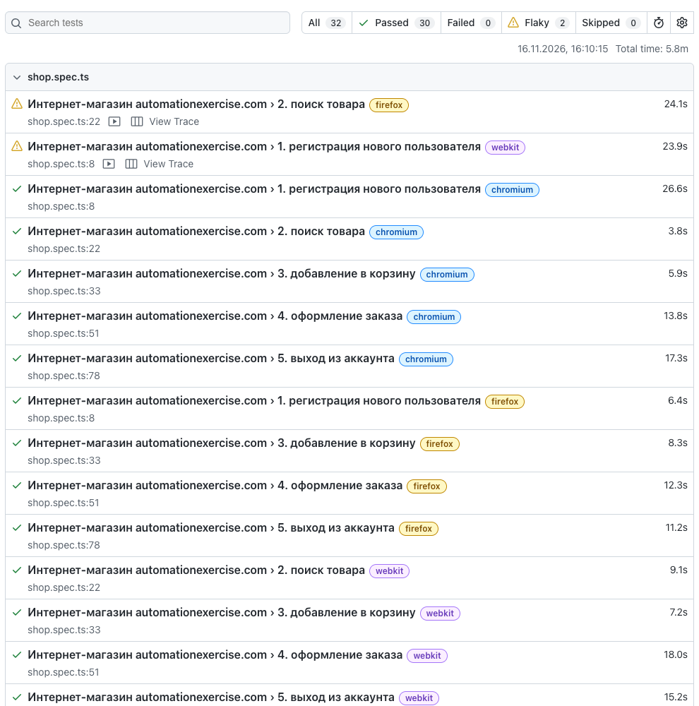{#l2-report width=15cm}

### 2.3.2 Задание 2. Page Object для каталога и корзины

**Текст задания.** Реализуйте Page Object для страницы каталога и страницы корзины.

`CatalogPage` хранит локаторы поля поиска, кнопки, заголовка выдачи, карточек товаров и всплывающего окна «Added!». Метод `addToCart(index)` нажимает «Add to cart» у нужной карточки и закрывает окно, поэтому в тестах добавление товара занимает одну строку. `CartPage` описывает строки таблицы корзины и кнопку оформления, а метод `row(name)` находит строку по названию товара (листинг @lst:l2-po).

Листинг: {#l2-po} Page Object каталога (фрагмент) и корзины

```typescript
export class CatalogPage {
  constructor(page: Page) {
    this.page = page;
    this.searchInput = page.locator('#search_product');
    this.searchButton = page.locator('#submit_search');
    this.title = page.locator('.features_items h2.title');
    this.products = page.locator('.features_items .productinfo');
    this.modal = page.locator('#cartModal');
  }
  async addToCart(index: number) {
    await this.products.nth(index).locator('.add-to-cart').click();
    await this.modal.getByRole('button', { name: 'Continue Shopping' }).click();
  }
}

export class CartPage {
  constructor(page: Page) {
    this.page = page;
    this.rows = page.locator('#cart_info_table tbody tr');
    this.checkoutButton = page.getByText('Proceed To Checkout');
  }
  row(name: string) {
    return this.rows.filter({ hasText: name });
  }
}
```

### 2.3.3 Задание 3. Trace и видео упавшего теста

**Текст задания.** Настройте запись trace для упавших тестов и проанализируйте видео падения.

В конфигурации включены `trace: 'retain-on-failure'`, `video: 'retain-on-failure'` и `screenshot: 'only-on-failure'`. Для разбора я написал тест, который падает специально. Он дважды добавляет в корзину один и тот же товар и ожидает количество 1 (листинг @lst:l2-demo). Тест помечен тегом `@demo` и в обычный прогон не входит.

Листинг: {#l2-demo} Тест для разбора падения и результат запуска

```typescript
test('@demo корзина: повторное добавление того же товара', async ({ page }) => {
  const catalog = new CatalogPage(page);
  const cart = new CartPage(page);
  await catalog.goto();
  await catalog.addToCart(0);
  await catalog.addToCart(0);
  await cart.goto();
  await expect(cart.rows.first().locator('.cart_quantity button')).toHaveText('1');
});
```

```text
Error: expect(locator).toHaveText(expected) failed
Expected: "1"
Received: "2"
```

Trace открывается командой `npx playwright show-trace trace.zip` (рисунок @fig:l2-trace).. На упавшей проверке видно, что в корзине один товар Blue Top с количеством 2 и суммой Rs. 1000, то есть сайт не создает вторую строку, а увеличивает количество.

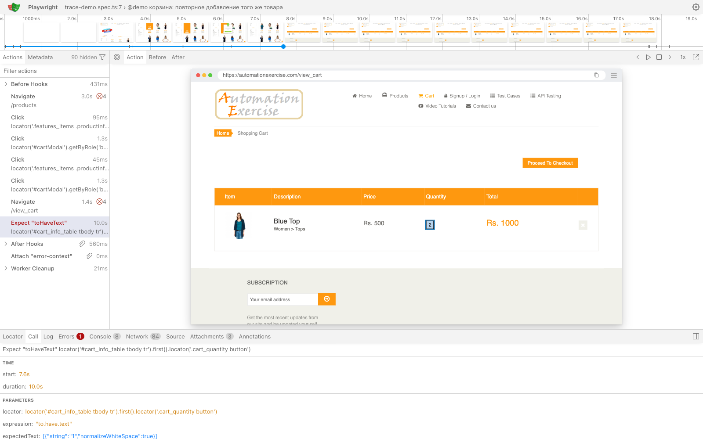{#l2-trace width=16.5cm}

Видео падения длится 19 секунд. На кадрах (рисунок @fig:l2-video) видно всю цепочку: каталог, первое окно «Added!», второе добавление того же товара, корзина с количеством 2. По видео и trace сразу понятно, что ошибка в ожидании теста, а не в сайте: ожидаемое значение нужно исправить на 2.

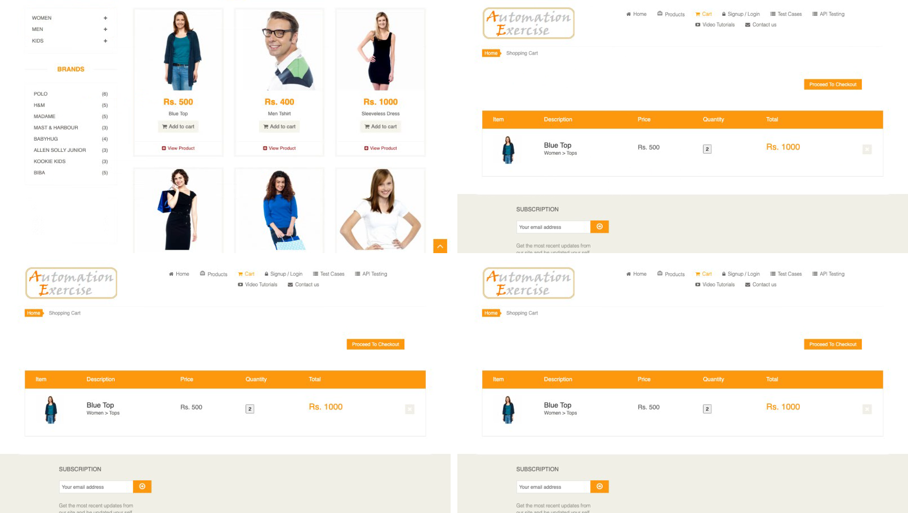{#l2-video width=16cm}

Дополнительно тесты запускаются в GitHub Actions: в workflow `lab2-e2e.yml` настроена матрица из четырех проектов, каждый в отдельной задаче, а HTML-отчет каждого сохраняется как артефакт. Запуск прошел успешно во всех четырех проектах (рисунок @fig:l2-ci).

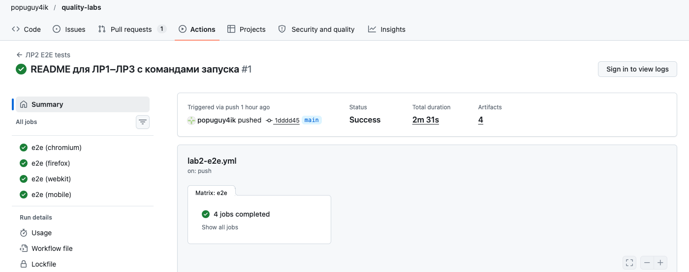{#l2-ci width=16.5cm}

## 2.4 Вывод

В работе написано 8 E2E-тестов для интернет-магазина automationexercise.com. Тесты организованы по паттерну Page Object: страницы входа, каталога и корзины описаны отдельными классами. Тесты проходят в Chromium, Firefox, WebKit и на мобильном Pixel 7, всего 32 запуска.

Нестабильность окружения устранена тремя мерами: блокировкой рекламы, повторами при перегрузке сайта и уникальными тестовыми данными. Для упавшего теста сохраняются trace и видео, по ним найдена причина падения.

{{pagebreak}}

# 3 Лабораторная работа № 3. Аудит производительности и доступности с Lighthouse CI

## 3.1 Цель работы

1. Освоить метрики Core Web Vitals (LCP, INP, CLS).
2. Научиться настраивать Lighthouse CI для автоматического аудита.
3. Изучить требования WCAG 2.1 AA к доступности.
4. Получить практические навыки интеграции аудита в CI/CD.
5. Понять принципы performance budgeting.

## 3.2 Ход работы

### 3.2.1 Тестируемое приложение

Аудит проводится на собственном сайте: это многостраничный сайт мессенджера «Сова» из лабораторных работ по веб-дизайну (8 HTML-страниц, CSS на дизайн-токенах, немного JavaScript). В проекте две версии сайта: `app-before` (исходная) и `app` (после оптимизации). Скрипт `build.mjs` копирует нужную версию в папку `dist`, оттуда ее раздает сервер `serve` на порту 3000, как в задании.

```text
lab3
├── app-before/            сайт до оптимизации
├── app/                   сайт после оптимизации
├── build.mjs              «сборка»: копирование версии в dist
├── lighthouserc.json      настройки Lighthouse CI, проверки и бюджет
├── lighthouserc.mobile.json  тот же аудит в мобильной эмуляции
└── package.json           скрипты build, build:before, lhci
```

Установлены `@lhci/cli` 0.15 и `serve`. Lighthouse CI запускается командой `npx lhci autorun`: она сама поднимает сервер (`startServerCommand`), делает по 3 прогона каждой страницы, проверяет условия и загружает отчеты.

### 3.2.2 Конфигурация

Конфигурация основана на файле из задания (листинг @lst:l3-rc). В нее добавлены три страницы вместо одной (главная, список возможностей и статья), проверка Total Blocking Time и бюджет ресурсов, о котором подробно в разделе 3.3.

Листинг: {#l3-rc} Файл lighthouserc.json

```json
{
  "ci": {
    "collect": {
      "url": ["http://localhost:3000/",
              "http://localhost:3000/features.html",
              "http://localhost:3000/post.html"],
      "startServerCommand": "npx serve dist -l 3000",
      "numberOfRuns": 3,
      "settings": { "preset": "desktop" }
    },
    "assert": {
      "assertions": {
        "categories:performance": ["error", { "minScore": 0.9 }],
        "categories:accessibility": ["error", { "minScore": 0.9 }],
        "categories:best-practices": ["warn", { "minScore": 0.9 }],
        "categories:seo": ["warn", { "minScore": 0.9 }],
        "largest-contentful-paint": ["error", { "maxNumericValue": 2500 }],
        "cumulative-layout-shift": ["error", { "maxNumericValue": 0.1 }],
        "total-blocking-time": ["error", { "maxNumericValue": 200 }],
        "resource-summary:script:size": ["error", { "maxNumericValue": 20480 }],
        "resource-summary:stylesheet:size": ["error", { "maxNumericValue": 15360 }],
        "resource-summary:font:size": ["error", { "maxNumericValue": 51200 }],
        "resource-summary:image:size": ["error", { "maxNumericValue": 204800 }],
        "resource-summary:total:size": ["error", { "maxNumericValue": 358400 }],
        "resource-summary:third-party:count": ["error", { "maxNumericValue": 2 }],
        "resource-summary:total:count": ["warn", { "maxNumericValue": 40 }]
      }
    },
    "upload": { "target": "temporary-public-storage" }
  }
}
```

INP в лаборатории не измеряется: Lighthouse не взаимодействует со страницей. Вместо него проверяется Total Blocking Time. Реальный INP взят из полевых данных CrUX (раздел 3.1).

### 3.2.3 Доступность (WCAG 2.1 AA)

Категория Accessibility в Lighthouse проверяет часть требований WCAG 2.1 AA: контраст текста не ниже 4,5:1, подписи у полей форм, `alt` у изображений, порядок заголовков, роли и атрибуты ARIA, язык страницы. У «Совы» на всех трех страницах 100 баллов, у обеих версий.

### 3.2.4 Интеграция с GitHub Actions

Workflow `.github/workflows/lab3-lighthouse.yml` повторяет файл из задания: установка зависимостей, сборка и `lhci autorun`. Поскольку в репозитории лежат все пять лабораторных, шаги выполняются в папке `lab3` (`working-directory`), а workflow срабатывает только при изменениях в ней. Запуск в GitHub Actions прошел успешно: все проверки и бюджет выполнены на сервере Ubuntu так же, как локально (рисунок @fig:l3-ci).

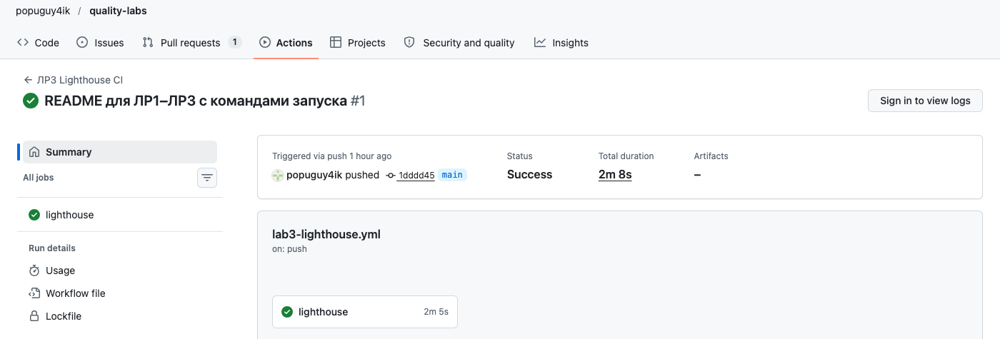{#l3-ci width=16.5cm}

## 3.3 Задания для самостоятельного выполнения

### 3.3.1 Задание 1. Аудит трех публичных сайтов

**Текст задания.** Проведите аудит 3 публичных сайтов (например, wikipedia.org, github.com, habr.com) и сравните их Core Web Vitals.

Использованы два источника. Полевые данные (CrUX) взяты из PageSpeed Insights: это реальные посещения пользователей Chrome за последние 28 дней, только в них есть INP. Лабораторные данные получены Lighthouse CI на этом компьютере, по 3 прогона в мобильной эмуляции, в таблице указаны медианы. Результаты собраны в таблицах @tbl:l3-field и @tbl:l3-lab.

Таблица: {#l3-field} Полевые данные Core Web Vitals, мобильные устройства (PageSpeed Insights, 28 дней)

| Показатель | Хорошо | ru.wikipedia.org | github.com | habr.com |
|---|---|---|---|---|
| LCP | < 2,5 с | 1,2 с | 4,9 с | 2,7 с |
| INP | < 200 мс | 130 мс | 285 мс | 261 мс |
| CLS | < 0,1 | 0 | 0,29 | 0,05 |
| FCP | < 1,8 с | 1,2 с | 2,6 с | 2,1 с |
| TTFB | < 0,8 с | 0,8 с | 1,7 с | 1,3 с |
| Оценка Core Web Vitals | | пройдена | не пройдена | не пройдена |

Таблица: {#l3-lab} Лабораторные данные Lighthouse (мобильная эмуляция, медиана 3 прогонов)

| Показатель | ru.wikipedia.org | github.com | habr.com |
|---|---|---|---|
| Performance | 98 | 66 | нет данных |
| Accessibility | 92 | 96 | нет данных |
| Best Practices | 78 | 93 | нет данных |
| SEO | 85 | 92 | нет данных |
| FCP / LCP | 0,84 / 0,85 с | 2,31 / 3,07 с | нет данных |
| TBT / CLS | 0 мс / 0,001 | 0 мс / 0,011 | нет данных |
| Вес страницы, запросов | 687 КБ, 36 | 4442 КБ, 117 | нет данных |

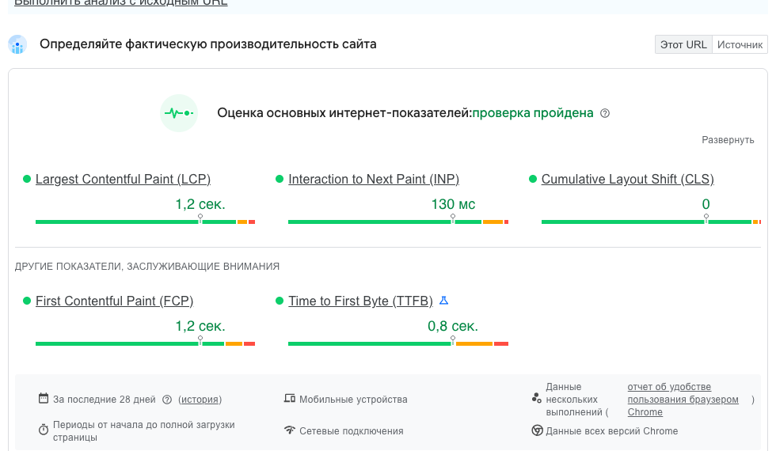{#l3-psi width=16cm}

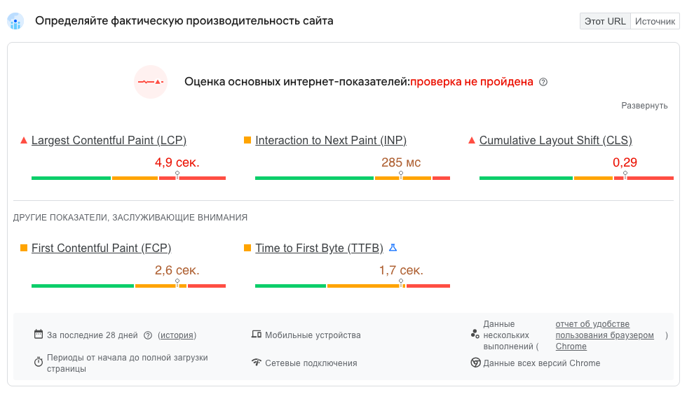{#l3-psigh width=16cm}

**Википедия** единственная проходит оценку Core Web Vitals: у реальных пользователей LCP 1,2 с и INP 130 мс. Страница почти целиком состоит из текста, скриптов мало, и все показатели в зеленой зоне.

**GitHub** не проходит по всем трем метрикам. Главная страница весит 4,4 МБ и делает 117 запросов: тяжелые изображения, видео и много JavaScript. CLS 0,29 у реальных пользователей означает, что блоки заметно сдвигаются при загрузке. В PageSpeed Insights, где тест идет на медленном мобильном устройстве, у GitHub 29 баллов и TBT 4,7 с.

**Хабр** проходит по LCP и CLS почти на границе, но не проходит по INP (261 мс): страница медленно реагирует на нажатия, скорее всего из-за большого объема JavaScript. Лабораторный аудит Хабра не удался ни на этом компьютере, ни в PageSpeed Insights: Lighthouse завершался ошибкой NO_FCP («страница ничего не отрисовала»).

Общий вывод: на большой аудитории проблемы видны именно в полевых данных. GitHub в лаборатории на быстром компьютере получил 66 баллов, а у реальных мобильных пользователей LCP почти 5 секунд.

### 3.3.2 Задание 2. Оптимизация своего сайта, «до» и «после»

**Текст задания.** Оптимизируйте свой сайт так, чтобы все метрики были в «зеленой зоне». Зафиксируйте «до» и «после».

По метрикам времени исходная версия «Совы» уже была в зеленой зоне: в лабораторных условиях LCP около 0,5 с на десктопе и 1,5 с в мобильной эмуляции. Но аудит с бюджетом ресурсов показал проблемы, которые на быстром соединении не видны (листинг @lst:l3-before).

Листинг: {#l3-before} Lighthouse CI на версии «до»: нарушения бюджета

```text
Checking assertions against 3 URL(s), 9 total run(s)
  ✘  resource-summary.font.size failure for maxNumericValue assertion
  ✘  resource-summary.third-party.count failure for maxNumericValue assertion
```

Шрифты с Google Fonts весили 104 КБ, а страница делала 5 запросов к сторонним серверам: таблица стилей шрифтов и файлы шрифтов. На медленном мобильном соединении это заметно: в PageSpeed Insights у опубликованной версии «до» мобильный LCP был 2,9 с, то есть хуже порога 2,5 с. Выполненные оптимизации:

1. Шрифты Inter и Manrope размещены на самом сайте и урезаны до символов, которые реально встречаются в текстах. Вместо 104 КБ стало 42 КБ.
2. Файл `@font-face` подключается неблокирующим способом (`media="print"` и `onload`), поэтому шрифты больше не конкурируют с фоновой картинкой первого экрана за канал.
3. Пять CSS-файлов собраны в один минифицированный: меньше блокирующих запросов.
4. Фоновое фото первого экрана подгружается заранее (`<link rel="preload">`), для телефонов сделана облегченная версия в AVIF (9 КБ вместо 25 КБ).
5. Первое чтение высоты страницы в скрипте прогресс-бара перенесено в `requestAnimationFrame`, чтобы убрать принудительную компоновку.

Результат: Lighthouse CI проходит все проверки без нарушений (листинг @lst:l3-after), сравнение в таблице @tbl:l3-ba и на рисунке @fig:l3-ba.

Листинг: {#l3-after} Lighthouse CI на версии «после»

```text
Checking assertions against 3 URL(s), 9 total run(s)
All results processed!
```

Таблица: {#l3-ba} Главная страница до и после оптимизации (медиана 3 прогонов)

| Показатель | До | После |
|---|---|---|
| Performance (desktop / mobile) | 100 / 100 | 100 / 100 |
| LCP desktop | 0,46 с | 0,49 с |
| FCP desktop | 0,44 с | 0,37 с |
| FCP mobile | 1,44 с | 1,37 с |
| CLS | 0,001 | 0 |
| TBT | 0 мс | 0 мс |
| Шрифты | 104,4 КБ | 41,7 КБ |
| Вся страница | 213,6 КБ | 144,7 КБ |
| Запросы к сторонним серверам | 5 | 0 |
| Нарушения бюджета | 2 | 0 |

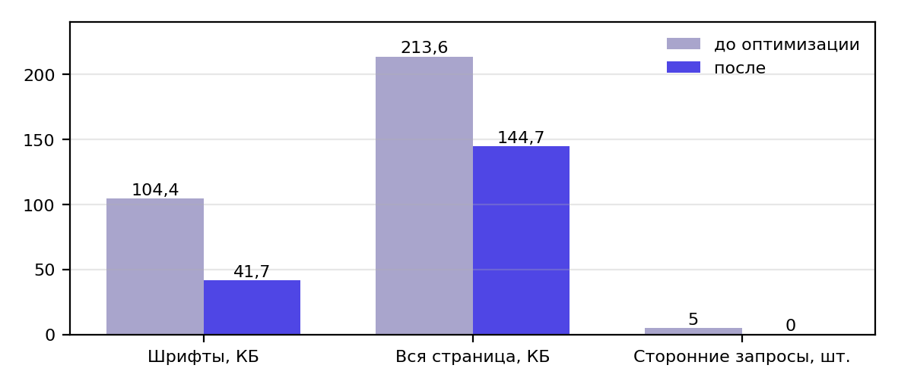{#l3-ba width=15cm}

Все метрики в зеленой зоне, страница стала легче на треть, а зависимость от сторонних серверов исчезла полностью. LCP на десктопе остался на прежнем уровне (разница 0,03 с в пределах погрешности): на быстром соединении он упирается не в загрузку, а во время отрисовки.

### 3.3.3 Задание 3. Performance budget

**Текст задания.** Настройте performance budget в `lighthouserc.json` и объясните, почему выбранные значения критичны для вашего проекта.

Бюджет задан проверками `resource-summary` в разделе `assertions` (листинг @lst:l3-rc). Значения и причины их выбора приведены в таблице @tbl:l3-budget.

Таблица: {#l3-budget} Бюджет производительности сайта «Сова»

| Ресурс | Бюджет | Сейчас | Почему такое значение |
|---|---|---|---|
| JavaScript | 20 КБ | 5,4 КБ | Сайт статический, JS нужен только для темы, меню, анимаций и формы. Рост скрипта сразу ухудшит TBT и INP на слабых телефонах |
| CSS | 15 КБ | 8,6 КБ | CSS блокирует отрисовку: все, что больше, задерживает первый экран |
| Шрифты | 50 КБ | 42 КБ | Два семейства шрифтов с кириллицей. Без ограничения шрифты легко вырастают до 100+ КБ, как было у Google Fonts |
| Изображения | 200 КБ | 81,5 КБ | Главная с фото первого экрана и обложками карточек. Это крупнейшая часть веса |
| Вся страница | 350 КБ | 145 КБ | На 3G (около 1,6 Мбит/с) 350 КБ грузятся около 2 секунд, что укладывается в цель LCP < 2,5 с |
| Сторонние запросы | 2 | 0 | Каждый сторонний домен требует отдельного соединения и может замедлить сайт без нашего контроля |
| Всего запросов | 40 | 15 | Предупреждение: много мелких запросов тоже тормозят загрузку |

Аудитория мессенджера часто пользуется медленной мобильной связью, где время загрузки напрямую зависит от веса страницы. Пример из работы: версия «до» проходила все проверки по времени, но не проходила бюджет, и именно эти превышения давали LCP 2,9 с в PageSpeed Insights.

Метрики времени (`largest-contentful-paint`, `cumulative-layout-shift`, `total-blocking-time`) заданы с уровнем `error`, поэтому их нарушение останавливает сборку. Общее число запросов задано как `warn`: превышение будет видно в отчете, но не заблокирует слияние.

## 3.4 Вывод

В работе настроен Lighthouse CI для сайта «Сова»: 3 страницы, по 3 прогона, проверки категорий, метрик Core Web Vitals и бюджета ресурсов. Аудит запускается локально командой `npx lhci autorun` и автоматически в GitHub Actions.

Сравнение трех публичных сайтов показало, что оценку Core Web Vitals из них проходит только Википедия. GitHub проваливает LCP и CLS из-за тяжелой страницы, Хабр проваливает INP.

Оптимизация сайта уменьшила вес главной страницы на треть, а шрифтов в 2,5 раза, и убрала все запросы к сторонним серверам. Все метрики в зеленой зоне, нарушений бюджета нет.

{{pagebreak}}

# 4 Лабораторная работа № 4. Нагрузочное тестирование с K6

## 4.1 Цель работы

1. Освоить инструмент K6 для нагрузочного тестирования.
2. Научиться создавать сценарии виртуальных пользователей.
3. Изучить метрики производительности (RPS, latency, error rate).
4. Получить практические навыки анализа узких мест.
5. Понять принципы stress-тестирования и soak-тестирования.

## 4.2 Ход работы

### 4.2.1 Установка и объекты тестирования

K6 версии 2.4 установлен через Homebrew командой `brew install k6`. Тестировались два объекта:

- публичный API jsonplaceholder.typicode.com для обычного нагрузочного теста (задание 1);
- собственный учебный API для stress- и soak-тестов (задания 2 и 3).

Stress- и soak-тесты на чужом публичном сервисе некорректны, поэтому для них написан API на Node.js без зависимостей (листинг @lst:l4-api).

Листинг: {#l4-api} Учебный API (api/server.js, основные маршруты)

```javascript
// GET /api/products — список из 50 товаров (легкий запрос)
if (req.method === 'GET' && url.pathname === '/api/products') return json(res, 200, products);

// POST /api/auth — авторизация: хеширование пароля нагружает процессор
if (req.method === 'POST' && url.pathname === '/api/auth') {
  const body = JSON.parse(await readBody(req));
  crypto.pbkdf2Sync(body.password, body.email, 20_000, 32, 'sha256');
  const token = crypto.randomBytes(16).toString('hex');
  // Ошибка, которую ищет soak-тест: в режиме LEAK сессии никогда не удаляются
  sessions.set(token, { email: body.email, created: Date.now(),
                        profile: crypto.randomBytes(3072).toString('base64') });
  return json(res, 200, { token });
}

// GET /metrics — память процесса и число сессий для мониторинга
```

Для stress-теста API запускался в Docker с ограничением в 1 процессор и 256 МБ памяти, чтобы предел производительности был определенным и не зависел от загрузки компьютера. Маршрут `/metrics` отдает потребление памяти, по нему soak-тест отслеживает утечки.

### 4.2.2 Сценарий и запуск

Сценарий нагрузочного теста построен по шаблону из задания (листинг @lst:l4-load): пользователь запрашивает список постов, один пост и создает новый пост, потом ждет 1 секунду. Кастомные метрики `errors` (доля ошибок) и `create_duration` (время создания) добавляются через `Rate` и `Trend`. Пороги из задания: 95 % запросов быстрее 500 мс и меньше 1 % ошибок.

Листинг: {#l4-load} Сценарий scripts/load-test.js (фрагмент)

```javascript
export const options = {
  stages: [
    { duration: '10s', target: 1 }, { duration: '30s', target: 1 },
    { duration: '5s', target: 5 }, { duration: '30s', target: 5 },
    { duration: '5s', target: 10 }, { duration: '30s', target: 10 },
    { duration: '5s', target: 20 }, { duration: '30s', target: 20 },
    { duration: '5s', target: 30 }, { duration: '30s', target: 30 },
    { duration: '10s', target: 0 },
  ],
  thresholds: {
    http_req_duration: ['p(95)<500'],
    errors: ['rate<0.01'],
  },
};
const BASE_URL = 'https://jsonplaceholder.typicode.com';

export default function () {
  const list = http.get(`${BASE_URL}/posts`, { tags: { name: 'GET /posts' } });
  check(list, { 'posts status is 200': (r) => r.status === 200 });
  errorRate.add(list.status !== 200);
  const one = http.get(`${BASE_URL}/posts/1`, { tags: { name: 'GET /posts/1' } });
  const res = http.post(`${BASE_URL}/posts`, JSON.stringify({ title: 'k6', body: 'load test', userId: 1 }),
    { headers: { 'Content-Type': 'application/json; charset=UTF-8' } });
  createDuration.add(res.timings.duration);
  errorRate.add(res.status !== 201);
  sleep(1);
}
```

Нагрузка не плавная, а ступенчатая: на каждой ступени (1, 5, 10, 20 и 30 VU) число пользователей держится 30 секунд. Так в задании 1 можно надежно посчитать задержку для каждого числа пользователей. Запуск выполнен командой `k6 run --out json=results/load-jsonplaceholder.json scripts/load-test.js`: флаг `--out json` сохраняет каждое измерение, по ним потом строится график.

### 4.2.3 Веб-дашборд

Дашборд включается переменной `K6_WEB_DASHBOARD=true`, во время теста он доступен по адресу `http://localhost:5665`. С переменной `K6_WEB_DASHBOARD_EXPORT` k6 в конце теста сохраняет тот же дашборд в HTML-файл (рисунок @fig:l4-dash).

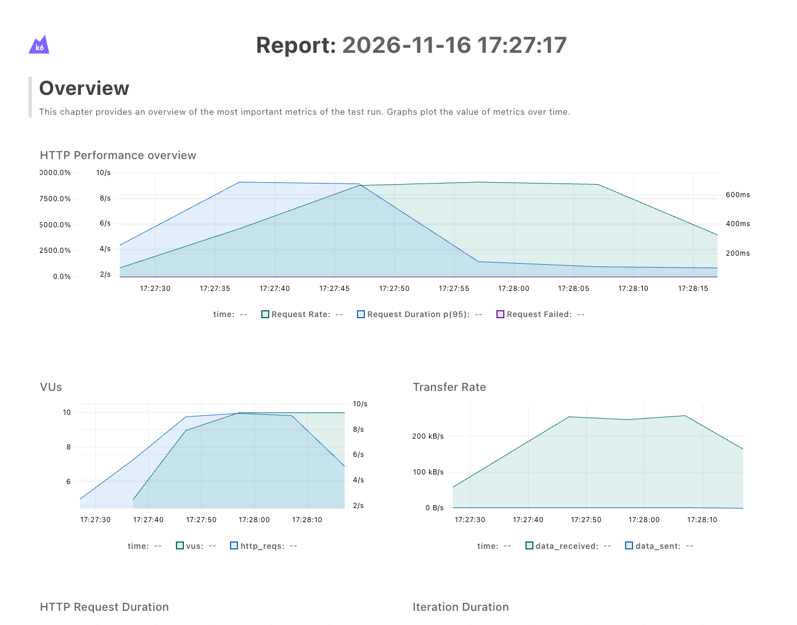{#l4-dash width=16cm}

### 4.2.4 Ключевые метрики

Итог нагрузочного теста приведен в листинге @lst:l4-summary и таблице @tbl:l4-metrics.

Листинг: {#l4-summary} Итог k6 run scripts/load-test.js

```text
  █ THRESHOLDS
    errors             ✓ 'rate<0.01' rate=0.00%
    http_req_duration  ✓ 'p(95)<500' p(95)=183.17ms

    checks_succeeded...: 100.00% 7124 out of 7124
    create_duration....: avg=178.43 min=157.69 med=175.42 max=610.10 p(95)=190.00
    http_req_duration..: avg=116.76ms min=69.54ms med=87.28ms max=610.1ms p(95)=183.17ms
    http_req_failed....: 0.00%  0 out of 5343
    http_reqs..........: 5343   28.04/s
    iterations.........: 1781   9.35/s
    vus_max............: 30
```

Таблица: {#l4-metrics} Ключевые метрики нагрузочного теста jsonplaceholder

| Метрика | Значение | Цель |
|---|---|---|
| http_reqs | 5343 (28 в секунду) | – |
| http_req_duration, p(95) | 183 мс | < 500 мс |
| http_req_failed | 0 % | < 1 % |
| vus | до 30 | – |
| iterations | 1781 | – |
| checks | 7124 из 7124 | – |

Оба порога выполнены, ошибок нет.

## 4.3 Задания для самостоятельного выполнения

### 4.3.1 Задание 1. Зависимость latency от числа VU

**Текст задания.** Проведите нагрузочный тест для любого публичного API (например, jsonplaceholder.typicode.com) и постройте график зависимости latency от количества VU.

По выгрузке `--out json` каждое измерение времени ответа привязано к числу VU в этот момент. Для каждой ступени посчитаны медиана, p95 и p99 (скрипт `scripts/plot_load.py`). Результат приведен в таблице @tbl:l4-vus и на рисунке @fig:l4-load.

Таблица: {#l4-vus} Время ответа jsonplaceholder в зависимости от числа VU

| VU | Запросов | Медиана | p95 | p99 | GET /posts | POST /posts |
|---|---|---|---|---|---|---|
| 1 | 95 | 83 мс | 178 мс | 352 мс | 82 мс | 174 мс |
| 5 | 350 | 86 мс | 181 мс | 273 мс | 86 мс | 174 мс |
| 10 | 671 | 86 мс | 180 мс | 188 мс | 85 мс | 175 мс |
| 20 | 1331 | 88 мс | 183 мс | 211 мс | 86 мс | 175 мс |
| 30 | 2050 | 88 мс | 185 мс | 201 мс | 86 мс | 176 мс |

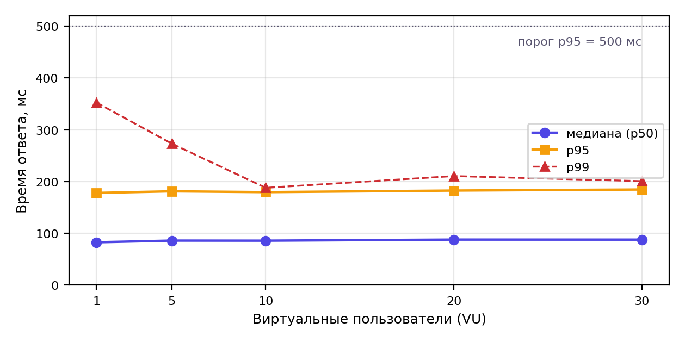{#l4-load width=16cm}

Время ответа почти не зависит от числа пользователей: медиана выросла с 83 до 88 мс, p95 держится около 180 мс. Jsonplaceholder работает за CDN Cloudflare, и 30 VU (около 28 запросов в секунду) для него ничтожная нагрузка, поэтому мы видим в основном сетевую задержку до сервера. Запросы на создание поста примерно вдвое медленнее чтения (175 против 85 мс): POST не кешируется в CDN и доходит до основного сервера. Высокий p99 на 1 и 5 VU объясняется маленькой выборкой: там всего 95 и 350 измерений, и несколько медленных первых запросов (установка TLS-соединения) заметно влияют на хвост распределения.

### 4.3.2 Задание 2. Stress-тест и точка деградации

**Текст задания.** Реализуйте stress-test: постепенно увеличивайте нагрузку до момента отказа и зафиксируйте точку деградации.

Для stress-теста использован исполнитель `ramping-arrival-rate`, то есть открытая модель нагрузки: k6 подает заданное число запросов в секунду независимо от того, успевает ли сервер их обрабатывать. Каждая ступень длится 30 секунд, 70 % запросов читают список товаров, 30 % проходят авторизацию. Тест останавливается автоматически, когда p95 превышает 1 секунду или ошибок больше 5 % (листинг @lst:l4-stress).

Листинг: {#l4-stress} Настройки stress-теста (scripts/stress-test.js)

```javascript
const RATES = (__ENV.RATES || '100,200,300,400,500,600,800,1000,1500').split(',').map(Number);
export const options = {
  scenarios: {
    stress: {
      executor: 'ramping-arrival-rate',
      startRate: 10, timeUnit: '1s',
      preAllocatedVUs: 100, maxVUs: 1500,
      stages: RATES.flatMap((r) => [{ duration: '10s', target: r }, { duration: '30s', target: r }]),
    },
  },
  thresholds: {
    http_req_duration: [{ threshold: 'p(95)<1000', abortOnFail: true, delayAbortEval: '20s' }],
    http_req_failed: [{ threshold: 'rate<0.05', abortOnFail: true, delayAbortEval: '20s' }],
  },
};
```

Первый прогон до 400 запросов в секунду отказа не дал: p95 был 5,5 мс, а сервис справлялся с запасом. Поэтому тест был продолжен вторым прогоном до 4000 запросов в секунду. Результаты по ступеням приведены в таблице @tbl:l4-stress и на рисунке @fig:l4-stress.

Таблица: {#l4-stress} Результаты stress-теста по ступеням

| Подано, запр./с | Обработано, запр./с | Медиана | p95 | p99 | Ошибки |
|---|---|---|---|---|---|
| 100 | 117 | 1,0 мс | 5,4 мс | 12 мс | 0 % |
| 300 | 317 | 0,4 мс | 3,5 мс | 6 мс | 0 % |
| 500 | 517 | 0,3 мс | 2,9 мс | 7 мс | 0 % |
| 800 | 834 | 0,9 мс | 3,9 мс | 7 мс | 0 % |
| 1000 | 1083 | 2,0 мс | 15,6 мс | 31 мс | 0 % |
| 1500 | 1516 | 19,5 мс | 123 мс | 161 мс | 0 % |
| 2000 | 1582 | 148 мс | 9998 мс | 10 000 мс | 8,0 % |
| 3000 | 1608 | 149 мс | 10 000 мс | 10 000 мс | 7,9 % |
| 4000 | 1111 | 148 мс | 10 000 мс | 10 000 мс | 8,8 % |

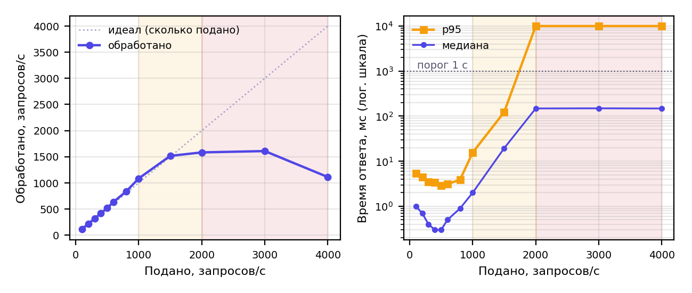{#l4-stress width=16.5cm}

По графику видны три зоны:

1. **До 1000 запросов в секунду** сервис обрабатывает все, что получает, p95 не больше 16 мс.
2. **От 1000 до 1500 запросов в секунду** начинается деградация. Все запросы еще обрабатываются, но время ответа растет в 8–10 раз: p95 со 16 до 123 мс. Процессор (1 ядро) почти полностью занят хешированием паролей, и запросы начинают ждать в очереди.
3. **От 2000 запросов в секунду** наступает отказ. Пропускная способность упирается в потолок около 1600 запросов в секунду, лишние запросы копятся в очереди и не дожидаются ответа: p95 достигает тайм-аута 10 секунд, около 8 % запросов завершаются ошибкой. K6 остановил тест по порогу `abortOnFail` (листинг @lst:l4-abort). Еще 155 тысяч запросов k6 не смог даже отправить: все 1500 виртуальных пользователей были заняты ожиданием (`dropped_iterations`).

Листинг: {#l4-abort} Остановка stress-теста по порогу

```text
http_req_duration....: avg=592.8ms med=133.13ms max=10.01s p(90)=182.17ms p(95)=3s
http_req_failed......: 4.91%  13993 out of 284552
http_reqs............: 284552 1408.75/s
dropped_iterations...: 155219 768.45/s
vus_max..............: 1500
level=error msg="thresholds on metrics 'http_req_duration' were crossed;
at least one has abortOnFail enabled, stopping test prematurely"
```

**Точка деградации:** около 1000 запросов в секунду (при доле авторизаций 30 %), **предел** около 1600 запросов в секунду. Узкое место однозначно процессор: синхронный `pbkdf2Sync` блокирует единственный поток Node.js, пока хеширует пароль. Для реального сервиса я бы перенес хеширование в асинхронный `crypto.pbkdf2` (он выполняется в пуле потоков libuv), а для роста нагрузки запустил бы несколько копий процесса.

### 4.3.3 Задание 3. Soak-тест и утечка памяти

**Текст задания.** Реализуйте soak-test: запустите тест на 30 минут с постоянной нагрузкой и выявите утечки памяти или деградацию производительности.

Soak-тест выполняется на двух версиях API одновременно и с одинаковой нагрузкой. В версии с ошибкой (`LEAK=1`) сессии после авторизации хранятся вечно. В исправленной версии раз в 10 секунд удаляются сессии старше минуты. Нагрузка: 20 VU в течение 30 минут, 70 % запросов к списку товаров и 30 % авторизаций, пауза 0,5 секунды (листинг @lst:l4-soak). Каждые 15 секунд скрипт `scripts/monitor.sh` записывает размер кучи процесса и число сессий из `/metrics`.

Листинг: {#l4-soak} Soak-тест (scripts/soak-test.js)

```javascript
export const options = {
  scenarios: { soak: { executor: 'constant-vus', vus: 20, duration: '30m' } },
  thresholds: { http_req_duration: ['p(95)<500'], http_req_failed: ['rate<0.01'] },
};
export default function () {
  if (Math.random() < 0.7) {
    http.get(`${BASE_URL}/api/products`, { tags: { name: 'products' } });
  } else {
    http.post(`${BASE_URL}/api/auth`, JSON.stringify({ email: `u${__VU}@test.local`, password: 'secret' }),
      { headers: { 'Content-Type': 'application/json' }, tags: { name: 'auth' } });
  }
  sleep(0.5);
}
```

Результаты приведены в таблице @tbl:l4-soak и на рисунке @fig:l4-soak.

Таблица: {#l4-soak} Результаты soak-теста (30 минут, 20 VU)

| Показатель | С утечкой | Исправленная |
|---|---|---|
| Запросов за 30 минут | 71 348 | 71 351 |
| Ошибки | 0 % | 0 % |
| p95 времени ответа (за весь тест) | 12,2 мс | 11,9 мс |
| p95 по 5-минутным окнам | 11,1 … 12,7 мс | 11,0 … 12,5 мс |
| Куча в начале / в конце | 6,8 / 93,4 МБ | 6,8 / 10,1 МБ |
| Сессий в памяти в конце | 21 220 | 204 |

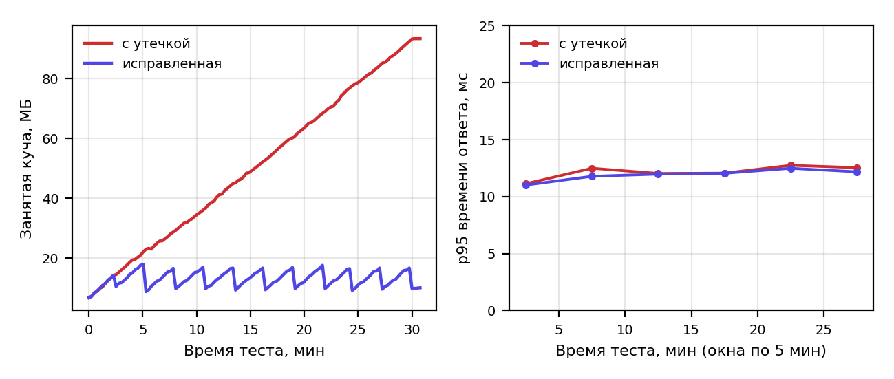{#l4-soak width=16.5cm}

По времени ответа версии не различаются: p95 держится около 12 мс все 30 минут, ошибок нет, оба порога выполнены. Если смотреть только на эти метрики, утечку не заметить.

Утечку показывает память. В версии с ошибкой куча растет линейно, примерно на 2,9 МБ в минуту, и за полчаса выросла с 6,8 до 93,4 МБ. Это около 4 КБ на каждую из 21 тысячи сессий, которые никто не удаляет. В исправленной версии график имеет форму «пилы»: сессии копятся около 2,5 минуты, затем просроченные удаляются, сборщик мусора освобождает память, и куча возвращается к 10 МБ. Растущего тренда нет.

Если экстраполировать, в контейнере с лимитом 256 МБ (как на stress-тесте) сервис с утечкой упадет по нехватке памяти примерно через 1 час 10 минут при такой нагрузке. Короткий нагрузочный тест на несколько минут эту ошибку бы не поймал: за 3 минуты куча вырастает всего на 9 МБ, что легко принять за обычное колебание.

В первой версии стенда данные сессии были одинаковой строкой `'x'.repeat(4096)`: через 16 минут память версий почти не отличалась (13,5 и 12,7 МБ). После замены на случайные данные утечка стала видна.

## 4.4 Вывод

В работе освоен k6 и проведены три вида тестов: нагрузочный, stress и soak. Для каждого составлен сценарий с порогами `thresholds`, результаты разобраны по выгрузке `--out json` и представлены графиками.

Нагрузочный тест jsonplaceholder (до 30 VU, 5343 запроса) прошел без ошибок, p95 = 183 мс при цели 500 мс. Время ответа почти не зависит от числа пользователей: сервис за CDN, и такая нагрузка для него незаметна.

Stress-тест собственного API в открытой модели нагрузки показал точку деградации около 1000 запросов в секунду и предел около 1600 запросов в секунду. После этого запросы копятся в очереди, время ответа достигает тайм-аута и появляются ошибки. Узкое место: синхронное хеширование паролей в единственном потоке Node.js.

Soak-тест длиной 30 минут нашел утечку памяти: куча росла на 2,9 МБ в минуту, хотя время ответа и доля ошибок оставались идеальными. Исправленная версия держит память на постоянном уровне.

{{pagebreak}}

# 5 Лабораторная работа № 5. Непрерывная интеграция и автоматизация контроля качества в GitHub Actions

## 5.1 Цель работы

1. Освоить GitHub Actions для автоматизации тестирования.
2. Научиться объединять юнит-тесты, E2E-тесты и аудит в единый пайплайн.
3. Изучить принципы quality gates и защиты веток.
4. Получить практические навыки настройки matrix-стратегии.
5. Понять принципы непрерывного контроля качества.

## 5.2 Ход работы

### 5.2.1 Проект и пайплайн

Пайплайн объединяет результаты предыдущих работ в один проект `lab5`:

- модули корзины, форматирования и проверки почты с 35 юнит-тестами из лабораторной работы 1;
- сайт «Сова» (папка `site`), который собирается в `dist`;
- E2E-тесты сайта на Playwright (6 сценариев) и визуальные скриншот-тесты (3 страницы);
- конфигурация Lighthouse CI с бюджетом производительности из лабораторной работы 3.

```text
lab5
├── src/                    модули и юнит-тесты (Vitest)
├── site/                   сайт «Сова»
├── e2e/site.spec.ts        E2E-сценарии сайта
├── e2e/visual.spec.ts      визуальные тесты
├── playwright.config.ts    3 браузера, сервер dist на порту 3000
├── lighthouserc.json       проверки Lighthouse и бюджет
├── vitest.config.js        пороги покрытия 80 %
└── build.mjs               сборка сайта в dist
```

Пайплайн описан в `.github/workflows/quality-gate.yml` (листинг @lst:l5-gate). Он запускается на push в ветки `main` и `develop`, на Pull Request в `main`, по расписанию и вручную. Этапы связаны через `needs`: сначала статический анализ, потом юнит-тесты, после них параллельно E2E и Lighthouse, в конце сводный отчет.

Листинг: {#l5-gate} Структура .github/workflows/quality-gate.yml (сокращено)

```yaml
name: Quality Gate
on:
  push: { branches: [main, develop] }
  pull_request: { branches: [main] }
  schedule:
    - cron: '0 6 * * *'
  workflow_dispatch:
defaults:
  run: { working-directory: lab5 }
jobs:
  lint:          # npm run lint и prettier --check
  unit-tests:    # needs: lint;        npm run test:coverage, артефакт coverage
  e2e-tests:     # needs: unit-tests;  matrix: [chromium, firefox, webkit]
    strategy:
      fail-fast: false
      matrix:
        browser: [chromium, firefox, webkit]
    steps:
      - run: npx playwright install --with-deps ${{ matrix.browser }}
      - run: npx playwright test --project=${{ matrix.browser }}
  lighthouse:    # needs: unit-tests;  npm run build и npx lhci autorun
  summary:       # needs: все этапы;   if: always(), падает, если хоть один этап не success
  deploy-reports:  # публикация отчетов на GitHub Pages
  nightly-report:  # только для запуска по расписанию: создает Issue с итогом
```

По сравнению с шаблоном из задания изменено следующее:

- Node.js 22 вместо 20 (текущая LTS) и кеш npm по `lab5/package-lock.json`, так как в репозитории несколько проектов;
- `fail-fast: false` в матрице: если E2E упадут в одном браузере, остальные доработают, и в отчете будет видно, где именно проблема;
- в `summary` учитывается и Lighthouse, а итог выводится таблицей в `GITHUB_STEP_SUMMARY`, то есть прямо на странице запуска;
- сервер для E2E поднимает сам Playwright (`webServer` в конфигурации), поэтому шаг `npx serve -s dist -l 3000 &` не нужен.

### 5.2.2 Локальная проверка этапов

Перед публикацией каждый этап пайплайна прогнан локально теми же командами (таблица @tbl:l5-local).

Таблица: {#l5-local} Результаты этапов при локальном запуске

| Этап | Команда | Результат |
|---|---|---|
| lint | `npm run lint`, `npm run format:check` | 0 проблем, все файлы отформатированы |
| unit-tests | `npm run test:coverage` | 35 из 35, покрытие строк и ветвей 100 % |
| e2e-tests | `npx playwright test` (без визуальных) | 18 из 18: 6 сценариев × 3 браузера |
| lighthouse | `npm run build && npx lhci autorun` | 3 страницы × 3 прогона, все проверки и бюджет пройдены |

Локальный прогон нашел ошибку конфигурации, которая уронила бы CI. Vitest по умолчанию ищет тесты по всему проекту и подхватывал файлы Playwright из `e2e/`. Юнит-тесты при этом проходили, но команда завершалась с ошибкой из-за двух «упавших» файлов. Исправлено параметром `include: ['src/**/*.test.js']` в `vitest.config.js`.

E2E-сценарии сайта приведены в таблице @tbl:l5-e2e.

Таблица: {#l5-e2e} E2E-тесты сайта «Сова»

| № | Сценарий | Проверки |
|---|---|---|
| 1 | Навигация | Заголовок первого экрана, переход в «Возможности», `aria-current="page"` у активного пункта |
| 2 | Темная тема | Переключатель меняет `data-theme`, `aria-pressed`, выбор сохраняется после перезагрузки |
| 3 | Мобильное меню | На ширине 375 px меню открывается, `aria-expanded="true"`, закрывается по Esc, фокус возвращается на кнопку |
| 4 | Форма контактов | Пустая отправка показывает ошибки и ставит фокус на первое поле, заполненная показывает подтверждение |
| 5 | Блог | 6 статей на первой странице, переход на вторую (3 статьи), хлебные крошки |
| 6 | Карточка возможности | Переход на детальную страницу, заголовок и хлебные крошки |

### 5.2.3 Защита ветки

Защита ветки `main` настроена в GitHub: Settings → Branches → Add classic branch protection rule, шаблон `main`. Включены «Require a pull request before merging» и «Require status checks to pass before merging». Обязательные проверки: `unit-tests` и `summary`. Задача `summary` зависит от всех остальных этапов и падает, если упал любой из них, поэтому ее достаточно для контроля всего пайплайна. Включен запрет обхода правил, он действует и на владельца репозитория (@fig:l5-protection).

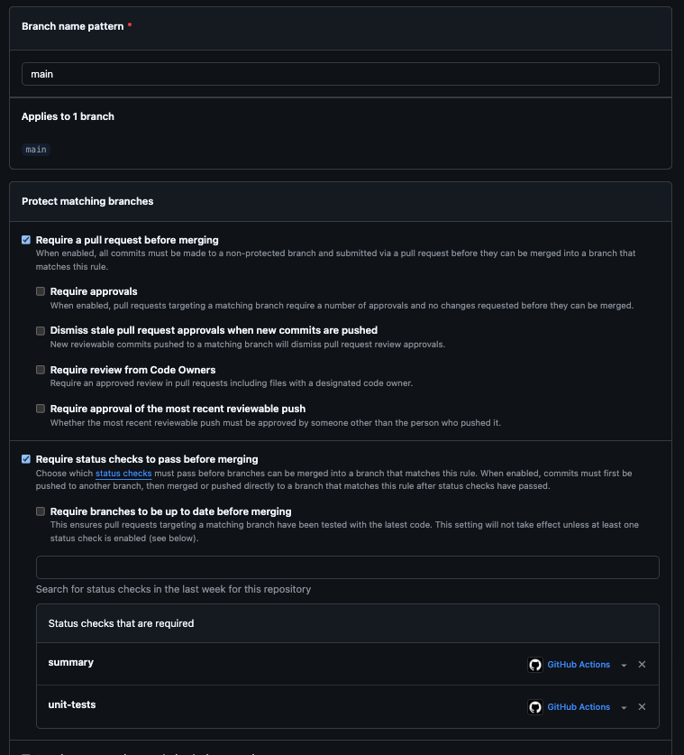{#l5-protection width=14cm}

### 5.2.4 Публикация отчетов и бейджи

Задача `deploy-reports` скачивает артефакты всех этапов (отчет о покрытии, HTML-отчеты Playwright по браузерам, отчеты Lighthouse) и публикует их в ветку `gh-pages` действием `peaceiris/actions-gh-pages`. Дополнительно она создает главную страницу со ссылками на отчеты и файл `coverage-badge.json`.

Вместо Codecov процент покрытия публикуется на тех же GitHub Pages: файл `coverage-badge.json` в формате shields.io читается сервисом бейджей. Так не нужен сторонний сервис и токен `CODECOV_TOKEN`. В `README.md` добавлены два бейджа:

```markdown


```

Отчеты опубликованы по адресу https://popuguy4ik.github.io/quality-labs/: на главной странице ссылки на отчет о покрытии, отчет Lighthouse и HTML-отчеты Playwright для каждого браузера. Бейджи в README показывают статус пайплайна и процент покрытия (рисунок @fig:l5-readme).

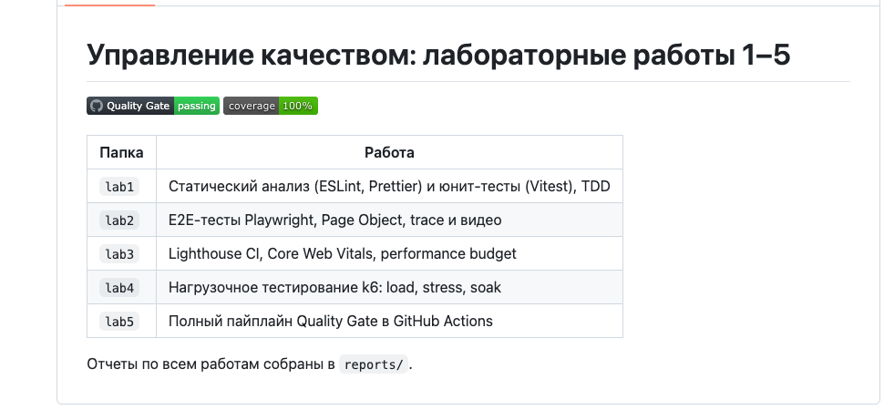{#l5-readme width=13cm}

## 5.3 Задания для самостоятельного выполнения

### 5.3.1 Задание 1. Блокировка PR при падении этапа

**Текст задания.** Настройте пайплайн с юнит-тестами и E2E-тестами. Убедитесь, что при падении любого этапа PR блокируется.

Пайплайн с юнит- и E2E-тестами настроен в разделе 2.1. Запуск на ветке `main` прошел полностью: все 7 задач, включая E2E в трех браузерах и визуальные тесты, Lighthouse, публикацию отчетов и сводку, выполнены успешно за 2 минуты 38 секунд (рисунок @fig:l5-main).

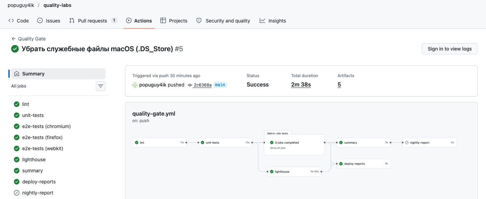{#l5-main width=16.5cm}

Чтобы проверить блокировку, я создал ветку `demo/broken-discount` с намеренной ошибкой: в функции `applyDiscount` деление на 100 заменено делением на 10. Из нее открыт Pull Request №1 в `main`. Пайплайн упал на этапе `unit-tests`: тест «should apply 10% discount» ожидал 90, а получил 0 (рисунок @fig:l5-pr). Этапы E2E и Lighthouse после этого не запускались, потому что зависят от юнит-тестов (`needs`), а сводка `summary` завершилась с ошибкой.

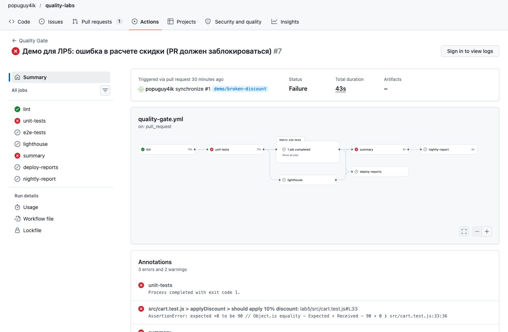{#l5-pr width=16.5cm}

На странице PR обе обязательные проверки отмечены как Required и завершились с ошибкой. Кнопка «Merge pull request» неактивна (@fig:l5-pr-blocked).

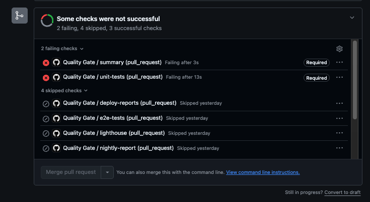{#l5-pr-blocked width=14cm}

Демонстрационный PR закрыт без слияния.

### 5.3.2 Задание 2. Визуальное регрессионное тестирование

**Текст задания.** Добавьте визуальное регрессионное тестирование через Chromatic или Playwright screenshot-тесты.

Выбраны screenshot-тесты Playwright: они не требуют стороннего сервиса и работают в том же пайплайне. Тест открывает страницу и сравнивает снимок первого экрана с эталоном через `toHaveScreenshot` (листинг @lst:l5-visual). Допускается отличие не более 1 % пикселей. Анимации отключаются, а карта OpenStreetMap на странице контактов блокируется, потому что ее тайлы каждый раз загружаются по-разному.

Листинг: {#l5-visual} Визуальные тесты (e2e/visual.spec.ts)

```typescript
test.describe('Визуальные тесты', () => {
  test.use({ viewport: { width: 1280, height: 800 } });

  for (const [name, path] of [['home', '/'], ['features', '/features.html'], ['contacts', '/contacts.html']]) {
    test(`первый экран: ${name}`, async ({ page }) => {
      await page.emulateMedia({ colorScheme: 'light', reducedMotion: 'reduce' });
      await page.route('**/openstreetmap.org/**', (r) => r.abort());
      await page.goto(path);
      await page.evaluate(() => document.fonts.ready);
      await expect(page).toHaveScreenshot(`${name}.png`);
    });
  }
});
```

Эталонные скриншоты зависят от ОС: шрифты сглаживаются в macOS и Linux по-разному. Поэтому эталоны снимает отдельный workflow `update-screenshots.yml` на той же Ubuntu, что и пайплайн. В конфигурации путь к эталонам не содержит имени ОС (`snapshotPathTemplate`), а визуальные тесты запускаются только в Chromium.

Workflow `update-screenshots.yml` запускается автоматически при изменении файла визуальных тестов. Он снял три эталона на Ubuntu и закоммитил их от имени `github-actions[bot]`. После этого визуальные тесты в пайплайне проходят (рисунок @fig:l5-main, задача e2e-tests (chromium)). Если изменение верстки сдвинет блоки на первом экране, тест упадет, а в HTML-отчете Playwright будут три картинки: эталон, текущий снимок и разница между ними.

### 5.3.3 Задание 3. Nightly build

**Текст задания.** Реализуйте nightly build: запуск полного пайплайна по расписанию (cron) с отправкой отчета на email.

Запуск по расписанию задан строкой `cron: '0 6 * * *'`, то есть каждый день в 6:00 UTC (11:00 по Екатеринбургу). Для отправки отчета используется задача `nightly-report`, которая выполняется только при запуске по расписанию (листинг @lst:l5-nightly). Она создает в репозитории Issue с итогом quality gate и ссылками на запуск и отчеты. GitHub присылает уведомление о новом Issue на почту владельцу репозитория, поэтому отчет приходит на email без настройки SMTP-сервера и хранения пароля почты в секретах.

Листинг: {#l5-nightly} Задача nightly-report

```yaml
nightly-report:
  runs-on: ubuntu-latest
  needs: [summary]
  if: always() && github.event_name == 'schedule'
  steps:
    - uses: actions/github-script@v7
      with:
        script: |
          const r = '${{ needs.summary.result }}';
          const url = `${context.serverUrl}/${context.repo.owner}/${context.repo.repo}/actions/runs/${context.runId}`;
          await github.rest.issues.create({
            owner: context.repo.owner, repo: context.repo.repo,
            title: `Nightly build ${new Date().toISOString().slice(0, 10)}: ${r === 'success' ? 'успех' : 'ошибка'}`,
            body: `Результат quality gate: **${r}**\n\nЗапуск: ${url}\nОтчеты: https://${context.repo.owner}.github.io/${context.repo.repo}/`,
          });
```

Условие `if: always()` нужно, чтобы отчет пришел и при неудачной ночной сборке.

Задача `nightly-report` срабатывает только для события `schedule`, ручной запуск (`workflow_dispatch`) Issue не создает.

## 5.4 Вывод

В работе собран пайплайн Quality Gate, который объединяет все инструменты из предыдущих работ: статический анализ, юнит-тесты с порогом покрытия, E2E-тесты в трех браузерах через matrix-стратегию, визуальные тесты и аудит Lighthouse с бюджетом производительности.

Quality gate вместе с защитой ветки делает проверки обязательными: изменение, которое ломает тесты, нельзя слить в `main`. Отчеты публикуются на GitHub Pages, состояние видно по бейджам в README, ночная сборка запускается ежедневно и создает Issue с отчетом.

