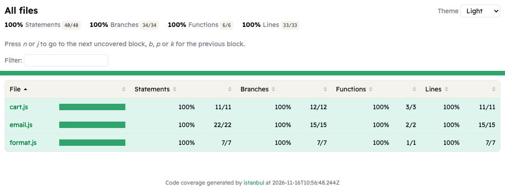
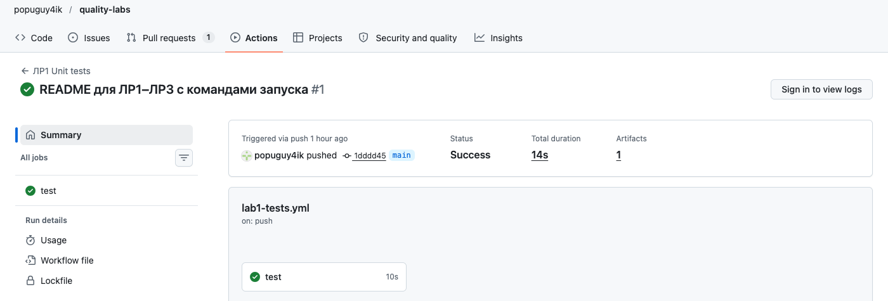

# 1 Цель работы

1. Освоить инструменты статического анализа JavaScript-кода.
2. Научиться настраивать ESLint и Prettier для обеспечения единого стиля кода.
3. Изучить методологию юнит-тестирования с использованием Vitest.
4. Получить практические навыки написания тестов для функций и модулей.
5. Понять принципы Test-Driven Development (TDD).

# 2 Ход работы

## 2.1 Проект и инструменты

Проект создан командой `npm init -y`, зависимости установлены командой `npm install --save-dev eslint @eslint/js prettier vitest @vitest/coverage-v8`. Использованы версии ESLint 10.15, Prettier 3.10, Vitest 5.1, Node.js 22. Структура проекта:

```text
lab1
├── eslint.config.js     правила ESLint
├── .prettierrc.json     правила форматирования
├── vitest.config.js     настройки покрытия и пороги 80 %
├── package.json         скрипты test, test:coverage, lint, format
└── src
    ├── cart.js          модуль корзины (calculateTotal, applyDiscount)
    ├── cart.test.js
    ├── format.js        задание 1 (formatCurrency)
    ├── format.test.js
    ├── email.js         задание 3 (validateEmail, TDD)
    └── email.test.js
```

## 2.2 ESLint и Prettier

Конфигурация ESLint взята из задания: рекомендуемый набор правил плюс `no-unused-vars`, `no-console`, `eqeqeq` и `prefer-const`. Проверка файла с типичными ошибками приведена в листинге @lst:badjs.

Листинг: {#badjs} Проверка файла с ошибками командой npx eslint examples/bad.js

```text
examples/bad.js
  2:5   error    'total' is never reassigned. Use 'const' instead  prefer-const
  3:7   error    'unused' is assigned a value but never used       no-unused-vars
  6:13  error    Expected '===' and instead saw '=='               eqeqeq
  7:5   error    'console' is not defined                          no-undef
  7:5   warning  Unexpected console statement                      no-console

✖ 5 problems (4 errors, 1 warning)
```

ESLint нашел все четыре нарушения из настроенных правил. Пятое сообщение `no-undef` дает рекомендуемый набор правил. Для `src/` команда `npm run lint` выдает 0 проблем.

Prettier настроен на одинарные кавычки и строку до 100 символов. Команда `npx prettier --check src/` подтверждает, что все файлы отформатированы.

## 2.3 Модуль корзины и тесты

Модуль `src/cart.js` и тесты `src/cart.test.js` написаны по заданию. Первый запуск показал 6 пройденных тестов и покрытие ветвей 91,7 %: не была проверена ветка `item.quantity || 1`, когда количество не указано. Я добавил тест на этот случай, и покрытие стало полным (листинг @lst:cart).

Листинг: {#cart} Добавленный тест для товара без количества

```javascript
it('should use quantity 1 when it is not set', () => {
  expect(calculateTotal([{ price: 40 }, { price: 10, quantity: 3 }])).toBe(70);
});
```

## 2.4 Запуск тестов и анализ покрытия

В `vitest.config.js` заданы пороги покрытия: 80 % по строкам и ветвям. Итоговый результат по всему проекту приведен в листинге @lst:cov и на рисунке @fig:cov.

Листинг: {#cov} Итог команды npm run test:coverage

```text
 Test Files  3 passed (3)
      Tests  35 passed (35)

=============================== Coverage summary ===============================
Statements   : 100% ( 40/40 )
Branches     : 100% ( 34/34 )
Functions    : 100% ( 6/6 )
Lines        : 100% ( 33/33 )
```

{#cov width=16cm}

# 3 Задания для самостоятельного выполнения

## 3.1 Задание 1. Функция formatCurrency

**Текст задания.** Добавьте функцию `formatCurrency(amount, currency)` и напишите для нее тесты (минимум 5 тест-кейсов).

Функция форматирует сумму через `Intl.NumberFormat` с русской локалью: два знака после запятой, разделение разрядов и знак валюты. Поддерживаются рубли, доллары и евро, по умолчанию рубли. На некорректную сумму (`NaN`, `Infinity`, строку) и неизвестную валюту функция бросает ошибку (листинг @lst:fmt).

Листинг: {#fmt} Функция formatCurrency (src/format.js)

```javascript
const SUPPORTED = ['RUB', 'USD', 'EUR'];

export const formatCurrency = (amount, currency = 'RUB') => {
  if (typeof amount !== 'number' || !Number.isFinite(amount)) {
    throw new Error('Amount must be a finite number');
  }
  if (!SUPPORTED.includes(currency)) {
    throw new Error(`Unsupported currency: ${currency}`);
  }
  return new Intl.NumberFormat('ru-RU', {
    style: 'currency', currency,
    minimumFractionDigits: 2, maximumFractionDigits: 2,
  }).format(amount);
};
```

Написано 9 тест-кейсов (таблица @tbl:fmt). `Intl` отделяет разряды и знак валюты неразрывным пробелом U+00A0, поэтому ожидаемые строки в тестах собраны через константу `NBSP`.

Таблица: {#fmt} Тест-кейсы formatCurrency

| № | Проверка | Вход | Ожидаемый результат |
|---|---|---|---|
| 1 | Рубли, разряды и копейки | 1234.5, RUB | 1 234,50 ₽ |
| 2 | Валюта по умолчанию | 100 | 100,00 ₽ |
| 3 | Доллары и евро | 99.9, USD / EUR | 99,90 $ / 99,90 € |
| 4 | Ноль | 0, RUB | 0,00 ₽ |
| 5 | Отрицательная сумма | -250, RUB | -250,00 ₽ |
| 6 | Округление до копеек | 10.456, RUB | 10,46 ₽ |
| 7 | Миллионы | 1000000, RUB | 1 000 000,00 ₽ |
| 8 | Некорректная сумма | '100', NaN, Infinity | ошибка |
| 9 | Неподдерживаемая валюта | 10, GBP | ошибка |

Все 9 тестов проходят, покрытие файла 100 %.

## 3.2 Задание 2. GitHub Actions

**Текст задания.** Настройте GitHub Actions для автоматического запуска тестов при каждом push.

Все лабораторные лежат в одном репозитории, поэтому workflow запускается только при изменениях в папке `lab1` (фильтр `paths`). Задача выполняет линтер, проверку форматирования и тесты с покрытием, а HTML-отчет о покрытии сохраняет как артефакт сборки (листинг @lst:ci).

Листинг: {#ci} Файл .github/workflows/lab1-tests.yml

```yaml
name: ЛР1 Unit tests
on:
  push:
    paths: ['lab1/**', '.github/workflows/lab1-tests.yml']
  pull_request:
    paths: ['lab1/**']
jobs:
  test:
    runs-on: ubuntu-latest
    defaults:
      run:
        working-directory: lab1
    steps:
      - uses: actions/checkout@v4
      - uses: actions/setup-node@v4
        with:
          node-version: 22
          cache: npm
          cache-dependency-path: lab1/package-lock.json
      - run: npm ci
      - run: npm run lint
      - run: npm run format:check
      - run: npm run test:coverage
      - uses: actions/upload-artifact@v4
        with:
          name: lab1-coverage
          path: lab1/coverage/
```

Первый же запуск в GitHub Actions прошел успешно за 14 секунд: линтер, проверка форматирования и 35 тестов с покрытием, отчет о покрытии сохранен как артефакт (рисунок @fig:ci). Репозиторий: https://github.com/popuguy4ik/quality-labs.

{#ci width=16.5cm}


## 3.3 Задание 3. validateEmail через TDD

**Текст задания.** Реализуйте функцию `validateEmail` через TDD: сначала напишите тесты, потом реализацию.

Работа шла по циклу «красный, зеленый, рефакторинг», каждый этап зафиксирован отдельным коммитом.

**Красный.** Сначала я описал требования тестами: 4 корректных адреса, обрезка пробелов, 11 некорректных случаев (нет `@`, два `@`, пустые части, домен без точки, однобуквенная зона, пробел внутри, точка в начале, две точки подряд, дефис в начале метки домена), слишком длинная локальная часть и значения не строкового типа. Вместо реализации стояла заглушка, которая бросает ошибку, поэтому все 18 тестов упали (листинг @lst:red).

Листинг: {#red} Первый запуск: тесты без реализации

```text
     × accepts valid address user@example.com 2ms
     × accepts valid address ilya.gugu@mail.ru 0ms
     × trims spaces around the address 0ms
     ...
 Test Files  1 failed (1)
      Tests  18 failed (18)
```

**Зеленый.** Затем написана минимальная реализация, которой хватает, чтобы пройти все тесты (листинг @lst:email). Адрес делится по `@` ровно на две части, локальная часть и каждая метка домена проверяются регулярными выражениями, зона должна состоять минимум из двух букв.

Листинг: {#email} Реализация validateEmail (src/email.js)

```javascript
const LOCAL = /^[A-Za-z0-9_%+-]+(\.[A-Za-z0-9_%+-]+)*$/;
const LABEL = /^[A-Za-z0-9]([A-Za-z0-9-]*[A-Za-z0-9])?$/;
const TLD = /^[A-Za-z]{2,}$/;

export const validateEmail = (value) => {
  if (typeof value !== 'string') return false;
  const email = value.trim();
  if (email.length > 254) return false;

  const parts = email.split('@');
  if (parts.length !== 2) return false;
  const [local, domain] = parts;

  if (local.length === 0 || local.length > 64 || !LOCAL.test(local)) return false;

  const labels = domain.split('.');
  if (labels.length < 2) return false;
  if (!labels.every((label) => LABEL.test(label))) return false;
  return TLD.test(labels[labels.length - 1]);
};
```

Все 18 тестов прошли.

**Рефакторинг.** Отчет о покрытии показал, что ветка с ограничением общей длины адреса (254 символа) ни одним тестом не проверяется. Я добавил тест на адрес длиной 259 символов, и покрытие файла стало 100 %. В итоге в проекте 35 тестов, все проходят (листинг @lst:cov).

История коммитов показывает порядок работы:

```text
ЛР1, задание 3 (TDD, green + refactor): реализация validateEmail
ЛР1, задание 3 (TDD, red): тесты validateEmail без реализации
ЛР1, задание 1: formatCurrency и 9 тестов
ЛР1: проект, ESLint, Prettier, модуль корзины и тесты
```

# 4 Вывод

В работе настроены ESLint и Prettier, написаны юнит-тесты на Vitest для модуля корзины и двух новых функций. Всего 35 тестов, покрытие кода 100 % по строкам, ветвям и функциям при пороге 80 %. Тесты и линтер запускаются в GitHub Actions при каждом изменении.

Отчет о покрытии выявил два непроверенных случая: товар без количества и слишком длинный адрес почты. Функция `validateEmail` написана по TDD, этапы зафиксированы отдельными коммитами.
