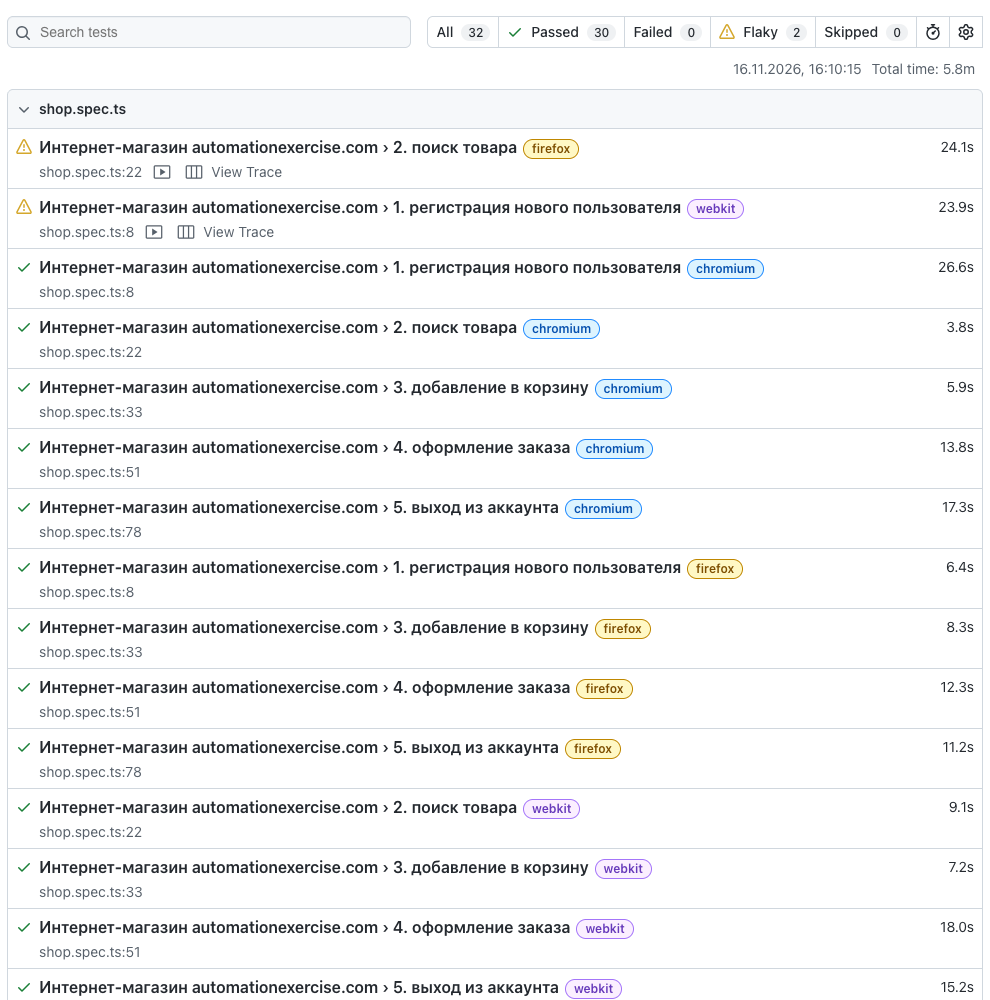
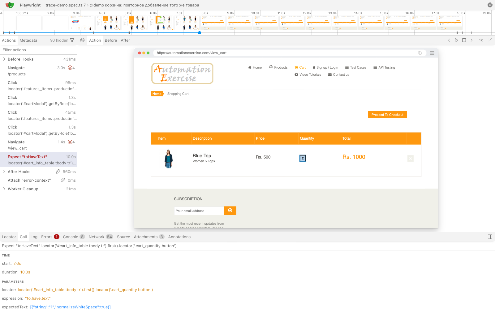
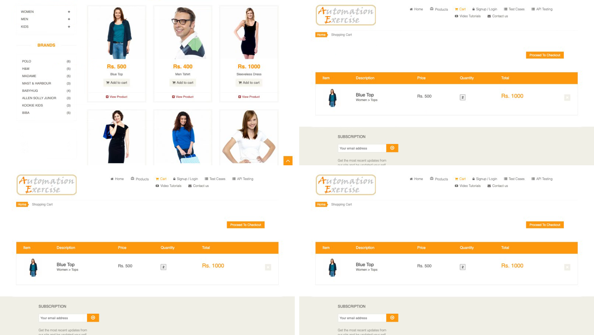

# 1 Цель работы

1. Освоить фреймворк Playwright для E2E-тестирования.
2. Научиться писать тесты, имитирующие действия реального пользователя.
3. Изучить паттерн Page Object Model для организации тестов.
4. Получить практические навыки тестирования на разных браузерах.
5. Понять принципы работы с локаторами и ассертами.

# 2 Ход работы

## 2.1 Проект

Проект на TypeScript, Playwright 1.65, браузеры Chromium, Firefox и WebKit установлены командой `npx playwright install`. Тестируемый сайт: automationexercise.com, учебный интернет-магазин, сделанный специально для тренировки автотестов. На нем есть регистрация, поиск, корзина и оформление заказа. Структура проекта:

```text
lab2
├── playwright.config.ts   браузеры, trace, видео, повторы
├── pages
│   ├── fixtures.ts        общая фикстура: блокировка рекламы
│   ├── LoginPage.ts       вход, регистрация, выход, удаление аккаунта
│   ├── CatalogPage.ts     каталог: поиск и добавление в корзину (задание 2)
│   └── CartPage.ts        корзина (задание 2)
└── tests
    ├── login.spec.ts      3 теста авторизации из задания
    ├── shop.spec.ts       5 сценариев магазина (задание 1)
    ├── trace-demo.spec.ts тест для разбора падения (задание 3)
    └── user.ts            генерация уникальных тестовых пользователей
```

## 2.2 Page Object и тесты авторизации

Класс `LoginPage` повторяет структуру из задания: поля страницы объявлены как `Locator`, а действия вынесены в методы `goto()` и `login()`. На сайте у полей есть атрибуты `data-qa`, специально предназначенные для автотестов, поэтому локаторы построены на них: такие локаторы не ломаются при изменении верстки и текстов. В класс добавлены методы `register()`, `logout()` и `deleteAccount()`, которые нужны сценариям магазина.

Тесты авторизации адаптированы под реальный сайт: после входа открывается главная страница, а не `/dashboard`, а сообщение об ошибке на английском. Проверка пустых полей использует встроенную валидацию браузера: `checkValidity()` у пустого поля почты возвращает `false`, и страница остается на `/login`.

При первом запуске тест «неверные данные» упал: вход с адресом `wrong@example.com` и паролем `wrongpass` прошел успешно. Оказалось, что на этом общем стенде кто-то уже зарегистрировал такой аккаунт. Теперь тест берет случайный адрес, которого точно нет. Это хорошо показывает, что на общих тестовых стендах нельзя полагаться на фиксированные тестовые данные.

## 2.3 Мультибраузерное тестирование

В `playwright.config.ts` настроены четыре проекта: Chromium, Firefox, WebKit (Safari) и мобильный Pixel 7. Основные параметры приведены в листинге @lst:config.

Листинг: {#config} Основные настройки playwright.config.ts

```typescript
export default defineConfig({
  testDir: './tests',
  grepInvert: process.env.DEMO ? undefined : /@demo/,
  timeout: 60_000,
  workers: 1,
  retries: 2,
  reporter: [['list'], ['html', { open: 'never' }]],
  use: {
    baseURL: 'https://automationexercise.com',
    trace: 'retain-on-failure',
    video: 'retain-on-failure',
    screenshot: 'only-on-failure',
  },
  projects: [
    { name: 'chromium', use: { ...devices['Desktop Chrome'] } },
    { name: 'firefox', use: { ...devices['Desktop Firefox'] } },
    { name: 'webkit', use: { ...devices['Desktop Safari'] } },
    { name: 'mobile', use: { ...devices['Pixel 7'] } },
  ],
});
```

Два решения вызваны особенностями сайта. На страницах много рекламы, которая открывает всплывающие окна и перекрывает кнопки. Поэтому в общей фикстуре `fixtures.ts` запросы к рекламным доменам блокируются через `page.route()`. Еще сайт публичный и под нагрузкой иногда отвечает страницей «This website is under heavy load (queue full)». Тест в этот момент падает не из-за ошибки в приложении, поэтому включены два повтора (`retries: 2`), а запуск идет в один поток, чтобы не добавлять сайту нагрузки.

# 3 Задания для самостоятельного выполнения

## 3.1 Задание 1. Пять E2E-тестов

**Текст задания.** Напишите 5 E2E-тестов для любого публичного сайта: регистрация, поиск, добавление в корзину, оформление заказа, выход.

Каждый тест независим от остальных: если ему нужен аккаунт, он регистрирует нового пользователя с уникальной почтой и в конце удаляет аккаунт, чтобы не оставлять мусор на общем стенде. Проверки сценариев приведены в таблице @tbl:tests.

Таблица: {#tests} Сценарии E2E-тестов

| № | Сценарий | Что проверяется |
|---|---|---|
| 1 | Регистрация | Анкета заполнена, появилось «Account Created!», в шапке «Logged in as», аккаунт удален |
| 2 | Поиск | По запросу «Jeans» открыт заголовок «Searched Products», найдено больше 0 товаров, в каждом названии есть «jeans» |
| 3 | Корзина | Два товара добавлены из каталога, в корзине 2 строки, у каждой количество 1 и сумма равна цене |
| 4 | Оформление заказа | После «Proceed To Checkout» в адресе доставки город пользователя, в заказе нужный товар, после «Place Order» открыта страница оплаты |
| 5 | Выход | После «Logout» открыта страница входа, надпись «Logged in as» пропала, повторный вход работает |

Оформление заказа проверяется до страницы оплаты. Платежные данные, даже тестовые, на чужом сайте я не ввожу: проверка того, что форма оплаты открылась с правильным заказом, уже покрывает сценарий оформления.

Сначала поиск проверялся запросом «Top», и тест падал: сайт ищет еще и по категории, поэтому в выдачу попадает, например, «Little Girls Mr. Panda Shirt» из раздела Tops. Для проверки «каждое название содержит запрос» выбран запрос «Jeans», по которому сайт возвращает ровно три подходящих товара (листинг @lst:search).

Листинг: {#search} Тест поиска с использованием Page Object

```typescript
test('2. поиск товара', async ({ page }) => {
  const catalog = new CatalogPage(page);
  await catalog.goto();
  await catalog.search('Jeans');

  await expect(catalog.title).toHaveText(/searched products/i);
  const names = await catalog.productNames();
  expect(names.length).toBeGreaterThan(0);
  for (const n of names) expect(n.toLowerCase()).toContain('jeans');
});
```

Итоговый прогон: 8 тестов (3 авторизации и 5 сценариев) в четырех проектах, всего 32 запуска за 5,8 минуты. 30 тестов прошли с первой попытки, 2 прошли со второй (Flaky): поиск в Firefox и регистрация в WebKit. Оба раза причина была в перегрузке сайта, а не в тесте. Сводка HTML-отчета приведена на рисунке @fig:report.

{#report width=15cm}

## 3.2 Задание 2. Page Object для каталога и корзины

**Текст задания.** Реализуйте Page Object для страницы каталога и страницы корзины.

`CatalogPage` хранит локаторы поля поиска, кнопки, заголовка выдачи, карточек товаров и всплывающего окна «Added!». Метод `addToCart(index)` нажимает «Add to cart» у нужной карточки и закрывает окно, поэтому в тестах добавление товара занимает одну строку. `CartPage` описывает строки таблицы корзины и кнопку оформления, а метод `row(name)` находит строку по названию товара (листинг @lst:po).

Листинг: {#po} Page Object каталога (фрагмент) и корзины

```typescript
export class CatalogPage {
  constructor(page: Page) {
    this.page = page;
    this.searchInput = page.locator('#search_product');
    this.searchButton = page.locator('#submit_search');
    this.title = page.locator('.features_items h2.title');
    this.products = page.locator('.features_items .productinfo');
    this.modal = page.locator('#cartModal');
  }
  async addToCart(index: number) {
    await this.products.nth(index).locator('.add-to-cart').click();
    await this.modal.getByRole('button', { name: 'Continue Shopping' }).click();
  }
}

export class CartPage {
  constructor(page: Page) {
    this.page = page;
    this.rows = page.locator('#cart_info_table tbody tr');
    this.checkoutButton = page.getByText('Proceed To Checkout');
  }
  row(name: string) {
    return this.rows.filter({ hasText: name });
  }
}
```

Благодаря Page Object тесты читаются как сценарий пользователя, а все селекторы собраны в одном месте. Если сайт поменяет верстку корзины, править придется только `CartPage`, а не каждый тест.

## 3.3 Задание 3. Trace и видео упавшего теста

**Текст задания.** Настройте запись trace для упавших тестов и проанализируйте видео падения.

В конфигурации включены `trace: 'retain-on-failure'`, `video: 'retain-on-failure'` и `screenshot: 'only-on-failure'`: запись идет всегда, но сохраняется только для упавших тестов, чтобы не занимать место. Для разбора я написал тест, который падает специально. Он дважды добавляет в корзину один и тот же товар и ожидает количество 1 (листинг @lst:demo). Тест помечен тегом `@demo` и в обычный прогон не входит.

Листинг: {#demo} Тест для разбора падения и результат запуска

```typescript
test('@demo корзина: повторное добавление того же товара', async ({ page }) => {
  const catalog = new CatalogPage(page);
  const cart = new CartPage(page);
  await catalog.goto();
  await catalog.addToCart(0);
  await catalog.addToCart(0);
  await cart.goto();
  await expect(cart.rows.first().locator('.cart_quantity button')).toHaveText('1');
});
```

```text
Error: expect(locator).toHaveText(expected) failed
Expected: "1"
Received: "2"
```

Trace открывается командой `npx playwright show-trace trace.zip` (рисунок @fig:trace). Слева список всех действий теста с длительностью, сверху лента кадров, в центре снимок страницы в момент выбранного действия. На упавшей проверке видно, что в корзине один товар Blue Top с количеством 2 и суммой Rs. 1000, то есть сайт не создает вторую строку, а увеличивает количество. На вкладках внизу доступны сетевые запросы (84) и сообщения консоли (8), а сам код упавшей проверки и ее параметры показаны в нижней панели.

{#trace width=16.5cm}

Видео падения длится 19 секунд. На кадрах (рисунок @fig:video) видно всю цепочку: каталог, первое окно «Added!», второе добавление того же товара, корзина с количеством 2. По видео и trace сразу понятно, что ошибка в ожидании теста, а не в сайте: поведение магазина логичное, и ожидаемое значение нужно исправить на 2.

{#video width=16cm}

Trace полезнее видео, когда тест падает в CI: в нем есть DOM на каждом шаге, сетевые запросы, консоль и точный код действия. Видео удобнее, чтобы быстро понять общий ход сценария.

Дополнительно тесты запускаются в GitHub Actions: в workflow `lab2-e2e.yml` настроена матрица из четырех проектов, а HTML-отчет каждого сохраняется как артефакт.

# 4 Вывод

В работе написано 8 E2E-тестов для интернет-магазина automationexercise.com. Тесты организованы по паттерну Page Object: страницы входа, каталога и корзины описаны отдельными классами. Тесты проходят в Chromium, Firefox, WebKit и на мобильном Pixel 7, всего 32 запуска.

E2E-тесты проверяют сайт так, как им пользуется человек, поэтому находят проблемы, которые юнит-тесты не видят. Но они медленнее и зависят от окружения. В работе это проявилось трижды: реклама перекрывала кнопки, перегруженный сайт отвечал заглушкой, а общий тестовый аккаунт ломал проверку неверного входа. Решения получились такие: блокировка лишних запросов, повторы для нестабильных тестов и уникальные тестовые данные для каждого запуска.

Trace и видео, сохраненные для упавшего теста, позволяют разобрать причину падения без повторного запуска: видно каждое действие, состояние страницы и сетевые запросы.
