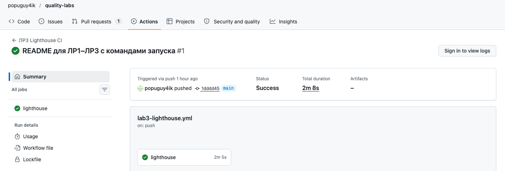
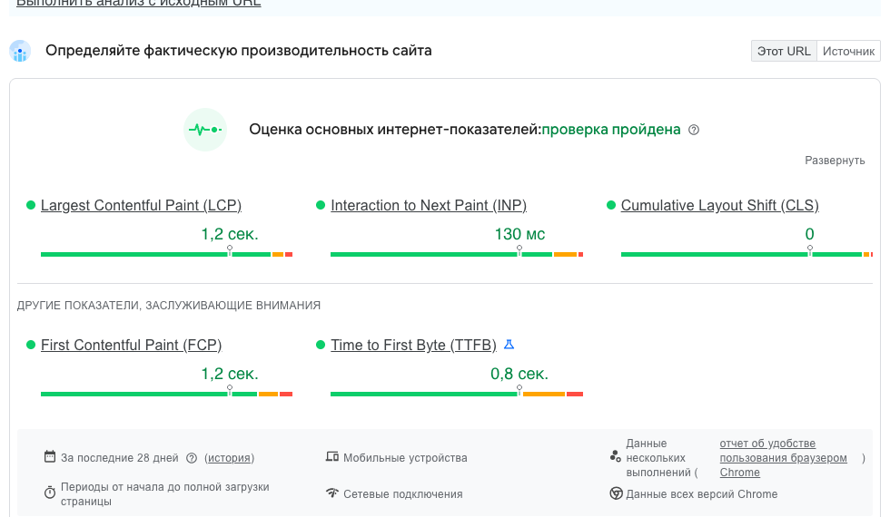
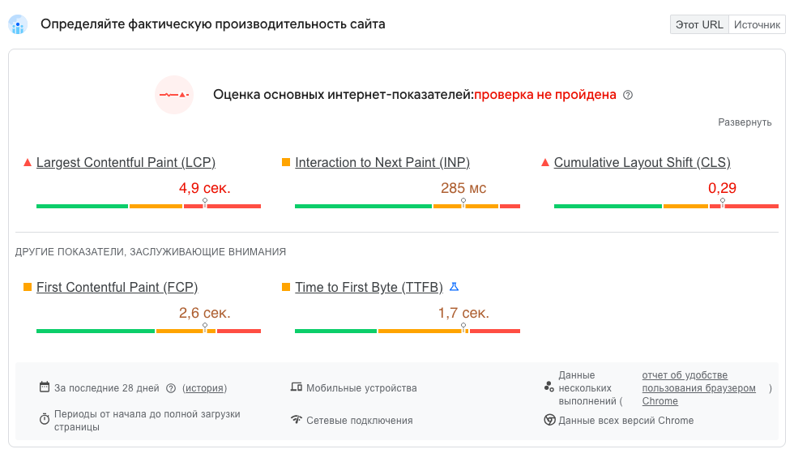
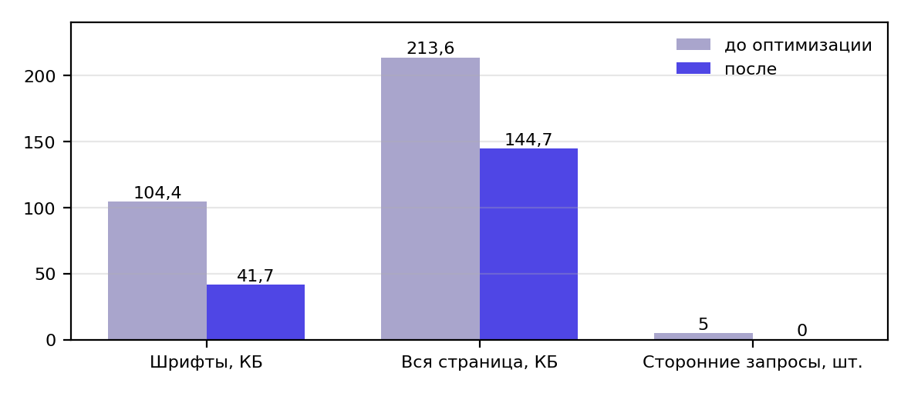

# 1 Цель работы

1. Освоить метрики Core Web Vitals (LCP, INP, CLS).
2. Научиться настраивать Lighthouse CI для автоматического аудита.
3. Изучить требования WCAG 2.1 AA к доступности.
4. Получить практические навыки интеграции аудита в CI/CD.
5. Понять принципы performance budgeting.

# 2 Ход работы

## 2.1 Тестируемое приложение

Аудит проводится на собственном сайте: это многостраничный сайт мессенджера «Сова» из лабораторных работ по веб-дизайну (8 HTML-страниц, CSS на дизайн-токенах, немного JavaScript). В проекте две версии сайта: `app-before` (исходная) и `app` (после оптимизации). Скрипт `build.mjs` копирует нужную версию в папку `dist`, оттуда ее раздает сервер `serve` на порту 3000, как в задании.

```text
lab3
├── app-before/            сайт до оптимизации
├── app/                   сайт после оптимизации
├── build.mjs              «сборка»: копирование версии в dist
├── lighthouserc.json      настройки Lighthouse CI, проверки и бюджет
├── lighthouserc.mobile.json  тот же аудит в мобильной эмуляции
└── package.json           скрипты build, build:before, lhci
```

Установлены `@lhci/cli` 0.15 и `serve`. Lighthouse CI запускается командой `npx lhci autorun`: она сама поднимает сервер (`startServerCommand`), делает по 3 прогона каждой страницы, проверяет условия и загружает отчеты.

## 2.2 Конфигурация

Конфигурация основана на файле из задания (листинг @lst:rc). В нее добавлены три страницы вместо одной (главная, список возможностей и статья), проверка Total Blocking Time и бюджет ресурсов, о котором подробно в разделе 3.3.

Листинг: {#rc} Файл lighthouserc.json

```json
{
  "ci": {
    "collect": {
      "url": ["http://localhost:3000/",
              "http://localhost:3000/features.html",
              "http://localhost:3000/post.html"],
      "startServerCommand": "npx serve dist -l 3000",
      "numberOfRuns": 3,
      "settings": { "preset": "desktop" }
    },
    "assert": {
      "assertions": {
        "categories:performance": ["error", { "minScore": 0.9 }],
        "categories:accessibility": ["error", { "minScore": 0.9 }],
        "categories:best-practices": ["warn", { "minScore": 0.9 }],
        "categories:seo": ["warn", { "minScore": 0.9 }],
        "largest-contentful-paint": ["error", { "maxNumericValue": 2500 }],
        "cumulative-layout-shift": ["error", { "maxNumericValue": 0.1 }],
        "total-blocking-time": ["error", { "maxNumericValue": 200 }],
        "resource-summary:script:size": ["error", { "maxNumericValue": 20480 }],
        "resource-summary:stylesheet:size": ["error", { "maxNumericValue": 15360 }],
        "resource-summary:font:size": ["error", { "maxNumericValue": 51200 }],
        "resource-summary:image:size": ["error", { "maxNumericValue": 204800 }],
        "resource-summary:total:size": ["error", { "maxNumericValue": 358400 }],
        "resource-summary:third-party:count": ["error", { "maxNumericValue": 2 }],
        "resource-summary:total:count": ["warn", { "maxNumericValue": 40 }]
      }
    },
    "upload": { "target": "temporary-public-storage" }
  }
}
```

INP в списке проверок нет, и это не ошибка. INP измеряет задержку реакции на действия пользователя, а Lighthouse в лаборатории ничего не нажимает. Вместо INP в лабораторных условиях смотрят на Total Blocking Time: если главный поток долго занят, страница будет медленно отвечать и на клики. Реальный INP есть только в полевых данных Chrome (CrUX), их я разбираю в разделе 3.1.

## 2.3 Доступность (WCAG 2.1 AA)

Категория Accessibility в Lighthouse проверяет часть требований WCAG 2.1 AA: контраст текста не ниже 4,5:1, подписи у полей форм, `alt` у изображений, порядок заголовков, роли и атрибуты ARIA, язык страницы. У «Совы» на всех трех страницах 100 баллов, у обеих версий. Это ожидаемо: доступность закладывалась при верстке (семантические теги, контраст проверен для обеих тем, видимый фокус). Автоматическая проверка не заменяет ручную: она не оценит, например, понятность текста ссылок или удобство работы с клавиатуры, поэтому эти пункты я проверял руками еще при верстке.

## 2.4 Интеграция с GitHub Actions

Workflow `.github/workflows/lab3-lighthouse.yml` повторяет файл из задания: установка зависимостей, сборка и `lhci autorun`. Поскольку в репозитории лежат все пять лабораторных, шаги выполняются в папке `lab3` (`working-directory`), а workflow срабатывает только при изменениях в ней. Токен `LHCI_GITHUB_APP_TOKEN` нужен, чтобы Lighthouse CI ставил статус проверки прямо в Pull Request. Без него аудит все равно выполняется, а ссылки на отчеты выводятся в лог. Запуск в GitHub Actions прошел успешно: все проверки и бюджет выполнены на сервере Ubuntu так же, как локально (рисунок @fig:ci).

{#ci width=16.5cm}

# 3 Задания для самостоятельного выполнения

## 3.1 Задание 1. Аудит трех публичных сайтов

**Текст задания.** Проведите аудит 3 публичных сайтов (например, wikipedia.org, github.com, habr.com) и сравните их Core Web Vitals.

Использованы два источника. Полевые данные (CrUX) взяты из PageSpeed Insights: это реальные посещения пользователей Chrome за последние 28 дней, только в них есть INP. Лабораторные данные получены Lighthouse CI на этом компьютере, по 3 прогона в мобильной эмуляции, в таблице указаны медианы. Результаты собраны в таблицах @tbl:field и @tbl:lab.

Таблица: {#field} Полевые данные Core Web Vitals, мобильные устройства (PageSpeed Insights, 28 дней)

| Показатель | Хорошо | ru.wikipedia.org | github.com | habr.com |
|---|---|---|---|---|
| LCP | < 2,5 с | 1,2 с | 4,9 с | 2,7 с |
| INP | < 200 мс | 130 мс | 285 мс | 261 мс |
| CLS | < 0,1 | 0 | 0,29 | 0,05 |
| FCP | < 1,8 с | 1,2 с | 2,6 с | 2,1 с |
| TTFB | < 0,8 с | 0,8 с | 1,7 с | 1,3 с |
| Оценка Core Web Vitals | | пройдена | не пройдена | не пройдена |

Таблица: {#lab} Лабораторные данные Lighthouse (мобильная эмуляция, медиана 3 прогонов)

| Показатель | ru.wikipedia.org | github.com | habr.com |
|---|---|---|---|
| Performance | 98 | 66 | нет данных |
| Accessibility | 92 | 96 | нет данных |
| Best Practices | 78 | 93 | нет данных |
| SEO | 85 | 92 | нет данных |
| FCP / LCP | 0,84 / 0,85 с | 2,31 / 3,07 с | нет данных |
| TBT / CLS | 0 мс / 0,001 | 0 мс / 0,011 | нет данных |
| Вес страницы, запросов | 687 КБ, 36 | 4442 КБ, 117 | нет данных |

{#psi width=16cm}

{#psigh width=16cm}

**Википедия** единственная проходит оценку Core Web Vitals: у реальных пользователей LCP 1,2 с и INP 130 мс. Страница почти целиком состоит из текста, скриптов мало, и все показатели в зеленой зоне. Более низкие оценки Best Practices (78) и SEO (85) в лаборатории не связаны со скоростью: эти категории проверяют другие вещи, например ошибки в консоли и оформление ссылок.

**GitHub** не проходит по всем трем метрикам. Главная страница весит 4,4 МБ и делает 117 запросов: тяжелые изображения, видео и много JavaScript. CLS 0,29 у реальных пользователей означает, что блоки заметно сдвигаются при загрузке. В PageSpeed Insights, где тест идет на медленном мобильном устройстве, у GitHub 29 баллов и TBT 4,7 с.

**Хабр** проходит по LCP и CLS почти на границе, но не проходит по INP (261 мс): страница медленно реагирует на нажатия, скорее всего из-за большого объема JavaScript. Лабораторный аудит Хабра не удался ни на этом компьютере, ни в PageSpeed Insights: Lighthouse завершался ошибкой NO_FCP («страница ничего не отрисовала»). Похоже, сайт отдает автоматическим клиентам пустую страницу или проверку на робота. Это хороший пример того, почему лабораторные данные надо дополнять полевыми.

Общий вывод: на большой аудитории проблемы видны именно в полевых данных. GitHub в лаборатории на быстром компьютере получил 66 баллов, а у реальных мобильных пользователей LCP почти 5 секунд.

## 3.2 Задание 2. Оптимизация своего сайта, «до» и «после»

**Текст задания.** Оптимизируйте свой сайт так, чтобы все метрики были в «зеленой зоне». Зафиксируйте «до» и «после».

По метрикам времени исходная версия «Совы» уже была в зеленой зоне: в лабораторных условиях LCP около 0,5 с на десктопе и 1,5 с в мобильной эмуляции. Но аудит с бюджетом ресурсов показал проблемы, которые на быстром соединении не видны (листинг @lst:before).

Листинг: {#before} Lighthouse CI на версии «до»: нарушения бюджета

```text
Checking assertions against 3 URL(s), 9 total run(s)
  ✘  resource-summary.font.size failure for maxNumericValue assertion
  ✘  resource-summary.third-party.count failure for maxNumericValue assertion
```

Шрифты с Google Fonts весили 104 КБ, а страница делала 5 запросов к сторонним серверам: таблица стилей шрифтов и файлы шрифтов. На медленном мобильном соединении это заметно: в PageSpeed Insights у опубликованной версии «до» мобильный LCP был 2,9 с, то есть хуже порога 2,5 с. Выполненные оптимизации:

1. Шрифты Inter и Manrope размещены на самом сайте и урезаны до символов, которые реально встречаются в текстах. Вместо 104 КБ стало 42 КБ.
2. Файл `@font-face` подключается неблокирующим способом (`media="print"` и `onload`), поэтому шрифты больше не конкурируют с фоновой картинкой первого экрана за канал.
3. Пять CSS-файлов собраны в один минифицированный: меньше блокирующих запросов.
4. Фоновое фото первого экрана подгружается заранее (`<link rel="preload">`), для телефонов сделана облегченная версия в AVIF (9 КБ вместо 25 КБ).
5. Первое чтение высоты страницы в скрипте прогресс-бара перенесено в `requestAnimationFrame`, чтобы убрать принудительную компоновку.

Результат: Lighthouse CI проходит все проверки без нарушений (листинг @lst:after), сравнение в таблице @tbl:ba и на рисунке @fig:ba.

Листинг: {#after} Lighthouse CI на версии «после»

```text
Checking assertions against 3 URL(s), 9 total run(s)
All results processed!
```

Таблица: {#ba} Главная страница до и после оптимизации (медиана 3 прогонов)

| Показатель | До | После |
|---|---|---|
| Performance (desktop / mobile) | 100 / 100 | 100 / 100 |
| LCP desktop | 0,46 с | 0,49 с |
| FCP desktop | 0,44 с | 0,37 с |
| FCP mobile | 1,44 с | 1,37 с |
| CLS | 0,001 | 0 |
| TBT | 0 мс | 0 мс |
| Шрифты | 104,4 КБ | 41,7 КБ |
| Вся страница | 213,6 КБ | 144,7 КБ |
| Запросы к сторонним серверам | 5 | 0 |
| Нарушения бюджета | 2 | 0 |

{#ba width=15cm}

Все метрики в зеленой зоне, страница стала легче на треть, а зависимость от сторонних серверов исчезла полностью. LCP на десктопе остался на прежнем уровне (разница 0,03 с в пределах погрешности): на быстром соединении он упирается не в загрузку, а во время отрисовки.

## 3.3 Задание 3. Performance budget

**Текст задания.** Настройте performance budget в `lighthouserc.json` и объясните, почему выбранные значения критичны для вашего проекта.

Бюджет задан проверками `resource-summary` в разделе `assertions` (листинг @lst:rc). Значения и причины их выбора приведены в таблице @tbl:budget.

Таблица: {#budget} Бюджет производительности сайта «Сова»

| Ресурс | Бюджет | Сейчас | Почему такое значение |
|---|---|---|---|
| JavaScript | 20 КБ | 5,4 КБ | Сайт статический, JS нужен только для темы, меню, анимаций и формы. Рост скрипта сразу ухудшит TBT и INP на слабых телефонах |
| CSS | 15 КБ | 8,6 КБ | CSS блокирует отрисовку: все, что больше, задерживает первый экран |
| Шрифты | 50 КБ | 42 КБ | Два семейства шрифтов с кириллицей. Без ограничения шрифты легко вырастают до 100+ КБ, как было у Google Fonts |
| Изображения | 200 КБ | 81,5 КБ | Главная с фото первого экрана и обложками карточек. Это крупнейшая часть веса |
| Вся страница | 350 КБ | 145 КБ | На 3G (около 1,6 Мбит/с) 350 КБ грузятся около 2 секунд, что укладывается в цель LCP < 2,5 с |
| Сторонние запросы | 2 | 0 | Каждый сторонний домен требует отдельного соединения и может замедлить сайт без нашего контроля |
| Всего запросов | 40 | 15 | Предупреждение: много мелких запросов тоже тормозят загрузку |

Главная мысль бюджета: аудитория мессенджера, который «работает даже на слабом интернете», часто сидит на медленной мобильной связи. Время загрузки на хорошем Wi-Fi почти не зависит от веса страницы, а на мобильной сети зависит напрямую. Бюджет ловит рост веса до того, как он превратится в плохой LCP у реальных пользователей. Пример из работы: версия «до» проходила все проверки по времени, но не проходила бюджет, и именно эти превышения давали LCP 2,9 с в PageSpeed Insights.

Метрики времени (`largest-contentful-paint`, `cumulative-layout-shift`, `total-blocking-time`) заданы с уровнем `error`, поэтому их нарушение останавливает сборку. Общее число запросов задано как `warn`: превышение будет видно в отчете, но не заблокирует слияние.

# 4 Вывод

В работе настроен Lighthouse CI для сайта «Сова»: 3 страницы, по 3 прогона, проверки категорий, метрик Core Web Vitals и бюджета ресурсов. Аудит запускается локально командой `npx lhci autorun` и автоматически в GitHub Actions.

Сравнение трех публичных сайтов показало, что оценку Core Web Vitals из них проходит только Википедия. GitHub проваливает LCP и CLS из-за тяжелой страницы, Хабр проваливает INP. Лабораторные и полевые данные дополняют друг друга: только полевые показывают INP и реальный опыт пользователей, а лабораторные позволяют повторить замер и найти причину.

Оптимизация сайта уменьшила вес главной страницы на треть, а шрифтов в 2,5 раза, и убрала все запросы к сторонним серверам. Все метрики в зеленой зоне, нарушений бюджета нет. Бюджет производительности оказался полезнее одних только метрик времени: он нашел проблему, которая в лаборатории на быстром соединении не влияла на баллы.
