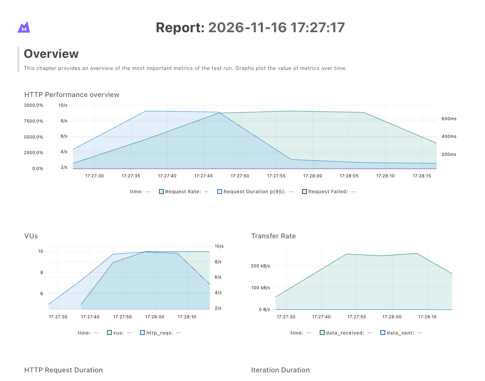
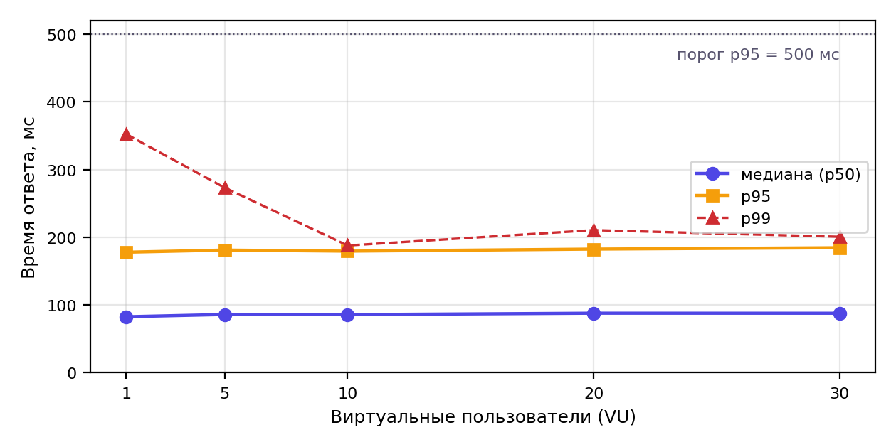
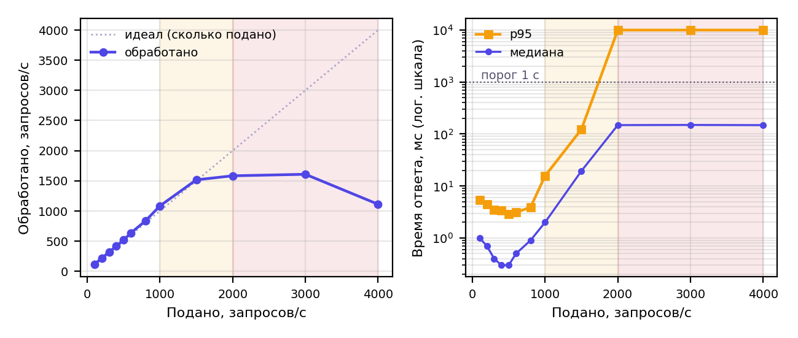
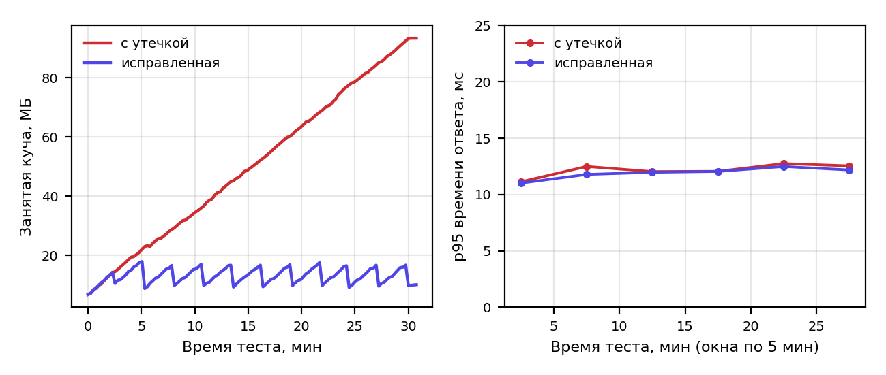

# 1 Цель работы

1. Освоить инструмент K6 для нагрузочного тестирования.
2. Научиться создавать сценарии виртуальных пользователей.
3. Изучить метрики производительности (RPS, latency, error rate).
4. Получить практические навыки анализа узких мест.
5. Понять принципы stress-тестирования и soak-тестирования.

# 2 Ход работы

## 2.1 Установка и объекты тестирования

K6 версии 2.4 установлен через Homebrew командой `brew install k6`. Тестировались два объекта:

- публичный API jsonplaceholder.typicode.com для обычного нагрузочного теста (задание 1);
- собственный учебный API для stress- и soak-тестов (задания 2 и 3).

Stress- и soak-тесты на чужом публичном сервисе некорректны, поэтому для них написан API на Node.js без зависимостей (листинг @lst:api).

Листинг: {#api} Учебный API (api/server.js, основные маршруты)

```javascript
// GET /api/products — список из 50 товаров (легкий запрос)
if (req.method === 'GET' && url.pathname === '/api/products') return json(res, 200, products);

// POST /api/auth — авторизация: хеширование пароля нагружает процессор
if (req.method === 'POST' && url.pathname === '/api/auth') {
  const body = JSON.parse(await readBody(req));
  crypto.pbkdf2Sync(body.password, body.email, 20_000, 32, 'sha256');
  const token = crypto.randomBytes(16).toString('hex');
  // Ошибка, которую ищет soak-тест: в режиме LEAK сессии никогда не удаляются
  sessions.set(token, { email: body.email, created: Date.now(),
                        profile: crypto.randomBytes(3072).toString('base64') });
  return json(res, 200, { token });
}

// GET /metrics — память процесса и число сессий для мониторинга
```

Для stress-теста API запускался в Docker с ограничением в 1 процессор и 256 МБ памяти, чтобы предел производительности был определенным и не зависел от загрузки компьютера. Маршрут `/metrics` отдает потребление памяти, по нему soak-тест отслеживает утечки.

## 2.2 Сценарий и запуск

Сценарий нагрузочного теста построен по шаблону из задания (листинг @lst:load): пользователь запрашивает список постов, один пост и создает новый пост, потом ждет 1 секунду. Кастомные метрики `errors` (доля ошибок) и `create_duration` (время создания) добавляются через `Rate` и `Trend`. Пороги из задания: 95 % запросов быстрее 500 мс и меньше 1 % ошибок.

Листинг: {#load} Сценарий scripts/load-test.js (фрагмент)

```javascript
export const options = {
  stages: [
    { duration: '10s', target: 1 }, { duration: '30s', target: 1 },
    { duration: '5s', target: 5 }, { duration: '30s', target: 5 },
    { duration: '5s', target: 10 }, { duration: '30s', target: 10 },
    { duration: '5s', target: 20 }, { duration: '30s', target: 20 },
    { duration: '5s', target: 30 }, { duration: '30s', target: 30 },
    { duration: '10s', target: 0 },
  ],
  thresholds: {
    http_req_duration: ['p(95)<500'],
    errors: ['rate<0.01'],
  },
};
const BASE_URL = 'https://jsonplaceholder.typicode.com';

export default function () {
  const list = http.get(`${BASE_URL}/posts`, { tags: { name: 'GET /posts' } });
  check(list, { 'posts status is 200': (r) => r.status === 200 });
  errorRate.add(list.status !== 200);
  const one = http.get(`${BASE_URL}/posts/1`, { tags: { name: 'GET /posts/1' } });
  const res = http.post(`${BASE_URL}/posts`, JSON.stringify({ title: 'k6', body: 'load test', userId: 1 }),
    { headers: { 'Content-Type': 'application/json; charset=UTF-8' } });
  createDuration.add(res.timings.duration);
  errorRate.add(res.status !== 201);
  sleep(1);
}
```

Нагрузка не плавная, а ступенчатая: на каждой ступени (1, 5, 10, 20 и 30 VU) число пользователей держится 30 секунд. Так в задании 1 можно надежно посчитать задержку для каждого числа пользователей. Запуск выполнен командой `k6 run --out json=results/load-jsonplaceholder.json scripts/load-test.js`: флаг `--out json` сохраняет каждое измерение, по ним потом строится график.

## 2.3 Веб-дашборд

Дашборд включается переменной `K6_WEB_DASHBOARD=true`, во время теста он доступен по адресу `http://localhost:5665`. С переменной `K6_WEB_DASHBOARD_EXPORT` k6 в конце теста сохраняет тот же дашборд в HTML-файл (рисунок @fig:dash).

{#dash width=16cm}

## 2.4 Ключевые метрики

Итог нагрузочного теста приведен в листинге @lst:summary и таблице @tbl:metrics.

Листинг: {#summary} Итог k6 run scripts/load-test.js

```text
  █ THRESHOLDS
    errors             ✓ 'rate<0.01' rate=0.00%
    http_req_duration  ✓ 'p(95)<500' p(95)=183.17ms

    checks_succeeded...: 100.00% 7124 out of 7124
    create_duration....: avg=178.43 min=157.69 med=175.42 max=610.10 p(95)=190.00
    http_req_duration..: avg=116.76ms min=69.54ms med=87.28ms max=610.1ms p(95)=183.17ms
    http_req_failed....: 0.00%  0 out of 5343
    http_reqs..........: 5343   28.04/s
    iterations.........: 1781   9.35/s
    vus_max............: 30
```

Таблица: {#metrics} Ключевые метрики нагрузочного теста jsonplaceholder

| Метрика | Значение | Цель |
|---|---|---|
| http_reqs | 5343 (28 в секунду) | – |
| http_req_duration, p(95) | 183 мс | < 500 мс |
| http_req_failed | 0 % | < 1 % |
| vus | до 30 | – |
| iterations | 1781 | – |
| checks | 7124 из 7124 | – |

Оба порога выполнены, ошибок нет.

# 3 Задания для самостоятельного выполнения

## 3.1 Задание 1. Зависимость latency от числа VU

**Текст задания.** Проведите нагрузочный тест для любого публичного API (например, jsonplaceholder.typicode.com) и постройте график зависимости latency от количества VU.

По выгрузке `--out json` каждое измерение времени ответа привязано к числу VU в этот момент. Для каждой ступени посчитаны медиана, p95 и p99 (скрипт `scripts/plot_load.py`). Результат приведен в таблице @tbl:vus и на рисунке @fig:load.

Таблица: {#vus} Время ответа jsonplaceholder в зависимости от числа VU

| VU | Запросов | Медиана | p95 | p99 | GET /posts | POST /posts |
|---|---|---|---|---|---|---|
| 1 | 95 | 83 мс | 178 мс | 352 мс | 82 мс | 174 мс |
| 5 | 350 | 86 мс | 181 мс | 273 мс | 86 мс | 174 мс |
| 10 | 671 | 86 мс | 180 мс | 188 мс | 85 мс | 175 мс |
| 20 | 1331 | 88 мс | 183 мс | 211 мс | 86 мс | 175 мс |
| 30 | 2050 | 88 мс | 185 мс | 201 мс | 86 мс | 176 мс |

{#load width=16cm}

Время ответа почти не зависит от числа пользователей: медиана выросла с 83 до 88 мс, p95 держится около 180 мс. Jsonplaceholder работает за CDN Cloudflare, и 30 VU (около 28 запросов в секунду) для него ничтожная нагрузка, поэтому мы видим в основном сетевую задержку до сервера. Запросы на создание поста примерно вдвое медленнее чтения (175 против 85 мс): POST не кешируется в CDN и доходит до основного сервера. Высокий p99 на 1 и 5 VU объясняется маленькой выборкой: там всего 95 и 350 измерений, и несколько медленных первых запросов (установка TLS-соединения) заметно влияют на хвост распределения.

## 3.2 Задание 2. Stress-тест и точка деградации

**Текст задания.** Реализуйте stress-test: постепенно увеличивайте нагрузку до момента отказа и зафиксируйте точку деградации.

Для stress-теста использован исполнитель `ramping-arrival-rate`, то есть открытая модель нагрузки: k6 подает заданное число запросов в секунду независимо от того, успевает ли сервер их обрабатывать. Каждая ступень длится 30 секунд, 70 % запросов читают список товаров, 30 % проходят авторизацию. Тест останавливается автоматически, когда p95 превышает 1 секунду или ошибок больше 5 % (листинг @lst:stress).

Листинг: {#stress} Настройки stress-теста (scripts/stress-test.js)

```javascript
const RATES = (__ENV.RATES || '100,200,300,400,500,600,800,1000,1500').split(',').map(Number);
export const options = {
  scenarios: {
    stress: {
      executor: 'ramping-arrival-rate',
      startRate: 10, timeUnit: '1s',
      preAllocatedVUs: 100, maxVUs: 1500,
      stages: RATES.flatMap((r) => [{ duration: '10s', target: r }, { duration: '30s', target: r }]),
    },
  },
  thresholds: {
    http_req_duration: [{ threshold: 'p(95)<1000', abortOnFail: true, delayAbortEval: '20s' }],
    http_req_failed: [{ threshold: 'rate<0.05', abortOnFail: true, delayAbortEval: '20s' }],
  },
};
```

Первый прогон до 400 запросов в секунду отказа не дал: p95 был 5,5 мс, а сервис справлялся с запасом. Поэтому тест был продолжен вторым прогоном до 4000 запросов в секунду. Результаты по ступеням приведены в таблице @tbl:stress и на рисунке @fig:stress.

Таблица: {#stress} Результаты stress-теста по ступеням

| Подано, запр./с | Обработано, запр./с | Медиана | p95 | p99 | Ошибки |
|---|---|---|---|---|---|
| 100 | 117 | 1,0 мс | 5,4 мс | 12 мс | 0 % |
| 300 | 317 | 0,4 мс | 3,5 мс | 6 мс | 0 % |
| 500 | 517 | 0,3 мс | 2,9 мс | 7 мс | 0 % |
| 800 | 834 | 0,9 мс | 3,9 мс | 7 мс | 0 % |
| 1000 | 1083 | 2,0 мс | 15,6 мс | 31 мс | 0 % |
| 1500 | 1516 | 19,5 мс | 123 мс | 161 мс | 0 % |
| 2000 | 1582 | 148 мс | 9998 мс | 10 000 мс | 8,0 % |
| 3000 | 1608 | 149 мс | 10 000 мс | 10 000 мс | 7,9 % |
| 4000 | 1111 | 148 мс | 10 000 мс | 10 000 мс | 8,8 % |

{#stress width=16.5cm}

По графику видны три зоны:

1. **До 1000 запросов в секунду** сервис обрабатывает все, что получает, p95 не больше 16 мс.
2. **От 1000 до 1500 запросов в секунду** начинается деградация. Все запросы еще обрабатываются, но время ответа растет в 8–10 раз: p95 со 16 до 123 мс. Процессор (1 ядро) почти полностью занят хешированием паролей, и запросы начинают ждать в очереди.
3. **От 2000 запросов в секунду** наступает отказ. Пропускная способность упирается в потолок около 1600 запросов в секунду, лишние запросы копятся в очереди и не дожидаются ответа: p95 достигает тайм-аута 10 секунд, около 8 % запросов завершаются ошибкой. K6 остановил тест по порогу `abortOnFail` (листинг @lst:abort). Еще 155 тысяч запросов k6 не смог даже отправить: все 1500 виртуальных пользователей были заняты ожиданием (`dropped_iterations`).

Листинг: {#abort} Остановка stress-теста по порогу

```text
http_req_duration....: avg=592.8ms med=133.13ms max=10.01s p(90)=182.17ms p(95)=3s
http_req_failed......: 4.91%  13993 out of 284552
http_reqs............: 284552 1408.75/s
dropped_iterations...: 155219 768.45/s
vus_max..............: 1500
level=error msg="thresholds on metrics 'http_req_duration' were crossed;
at least one has abortOnFail enabled, stopping test prematurely"
```

**Точка деградации:** около 1000 запросов в секунду (при доле авторизаций 30 %), **предел** около 1600 запросов в секунду. Узкое место однозначно процессор: синхронный `pbkdf2Sync` блокирует единственный поток Node.js, пока хеширует пароль. Для реального сервиса я бы перенес хеширование в асинхронный `crypto.pbkdf2` (он выполняется в пуле потоков libuv), а для роста нагрузки запустил бы несколько копий процесса.

## 3.3 Задание 3. Soak-тест и утечка памяти

**Текст задания.** Реализуйте soak-test: запустите тест на 30 минут с постоянной нагрузкой и выявите утечки памяти или деградацию производительности.

Soak-тест выполняется на двух версиях API одновременно и с одинаковой нагрузкой. В версии с ошибкой (`LEAK=1`) сессии после авторизации хранятся вечно. В исправленной версии раз в 10 секунд удаляются сессии старше минуты. Нагрузка: 20 VU в течение 30 минут, 70 % запросов к списку товаров и 30 % авторизаций, пауза 0,5 секунды (листинг @lst:soak). Каждые 15 секунд скрипт `scripts/monitor.sh` записывает размер кучи процесса и число сессий из `/metrics`.

Листинг: {#soak} Soak-тест (scripts/soak-test.js)

```javascript
export const options = {
  scenarios: { soak: { executor: 'constant-vus', vus: 20, duration: '30m' } },
  thresholds: { http_req_duration: ['p(95)<500'], http_req_failed: ['rate<0.01'] },
};
export default function () {
  if (Math.random() < 0.7) {
    http.get(`${BASE_URL}/api/products`, { tags: { name: 'products' } });
  } else {
    http.post(`${BASE_URL}/api/auth`, JSON.stringify({ email: `u${__VU}@test.local`, password: 'secret' }),
      { headers: { 'Content-Type': 'application/json' }, tags: { name: 'auth' } });
  }
  sleep(0.5);
}
```

Результаты приведены в таблице @tbl:soak и на рисунке @fig:soak.

Таблица: {#soak} Результаты soak-теста (30 минут, 20 VU)

| Показатель | С утечкой | Исправленная |
|---|---|---|
| Запросов за 30 минут | 71 348 | 71 351 |
| Ошибки | 0 % | 0 % |
| p95 времени ответа (за весь тест) | 12,2 мс | 11,9 мс |
| p95 по 5-минутным окнам | 11,1 … 12,7 мс | 11,0 … 12,5 мс |
| Куча в начале / в конце | 6,8 / 93,4 МБ | 6,8 / 10,1 МБ |
| Сессий в памяти в конце | 21 220 | 204 |

{#soak width=16.5cm}

По времени ответа версии не различаются: p95 держится около 12 мс все 30 минут, ошибок нет, оба порога выполнены. Если смотреть только на эти метрики, утечку не заметить.

Утечку показывает память. В версии с ошибкой куча растет линейно, примерно на 2,9 МБ в минуту, и за полчаса выросла с 6,8 до 93,4 МБ. Это около 4 КБ на каждую из 21 тысячи сессий, которые никто не удаляет. В исправленной версии график имеет форму «пилы»: сессии копятся около 2,5 минуты, затем просроченные удаляются, сборщик мусора освобождает память, и куча возвращается к 10 МБ. Растущего тренда нет.

Если экстраполировать, в контейнере с лимитом 256 МБ (как на stress-тесте) сервис с утечкой упадет по нехватке памяти примерно через 1 час 10 минут при такой нагрузке. Короткий нагрузочный тест на несколько минут эту ошибку бы не поймал: за 3 минуты куча вырастает всего на 9 МБ, что легко принять за обычное колебание.

В первой версии стенда данные сессии были одинаковой строкой `'x'.repeat(4096)`: через 16 минут память версий почти не отличалась (13,5 и 12,7 МБ). После замены на случайные данные утечка стала видна.

# 4 Вывод

В работе освоен k6 и проведены три вида тестов: нагрузочный, stress и soak. Для каждого составлен сценарий с порогами `thresholds`, результаты разобраны по выгрузке `--out json` и представлены графиками.

Нагрузочный тест jsonplaceholder (до 30 VU, 5343 запроса) прошел без ошибок, p95 = 183 мс при цели 500 мс. Время ответа почти не зависит от числа пользователей: сервис за CDN, и такая нагрузка для него незаметна.

Stress-тест собственного API в открытой модели нагрузки показал точку деградации около 1000 запросов в секунду и предел около 1600 запросов в секунду. После этого запросы копятся в очереди, время ответа достигает тайм-аута и появляются ошибки. Узкое место: синхронное хеширование паролей в единственном потоке Node.js.

Soak-тест длиной 30 минут нашел утечку памяти: куча росла на 2,9 МБ в минуту, хотя время ответа и доля ошибок оставались идеальными. Исправленная версия держит память на постоянном уровне.
