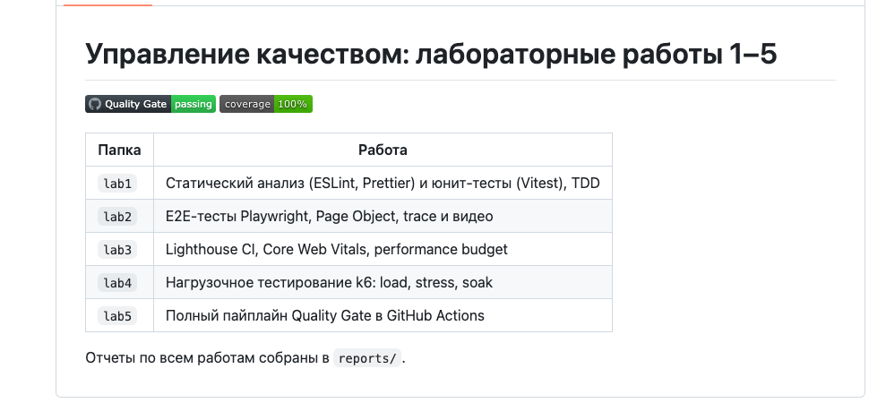
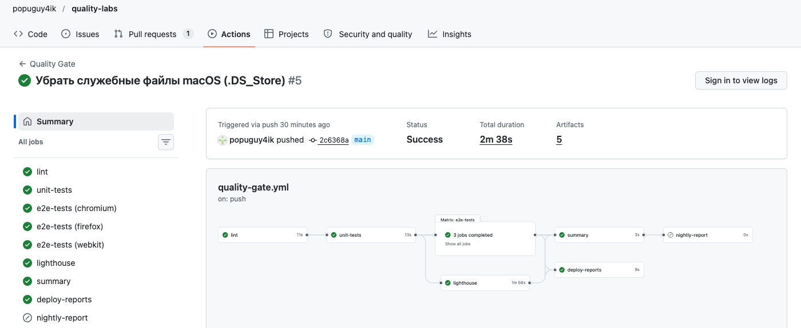
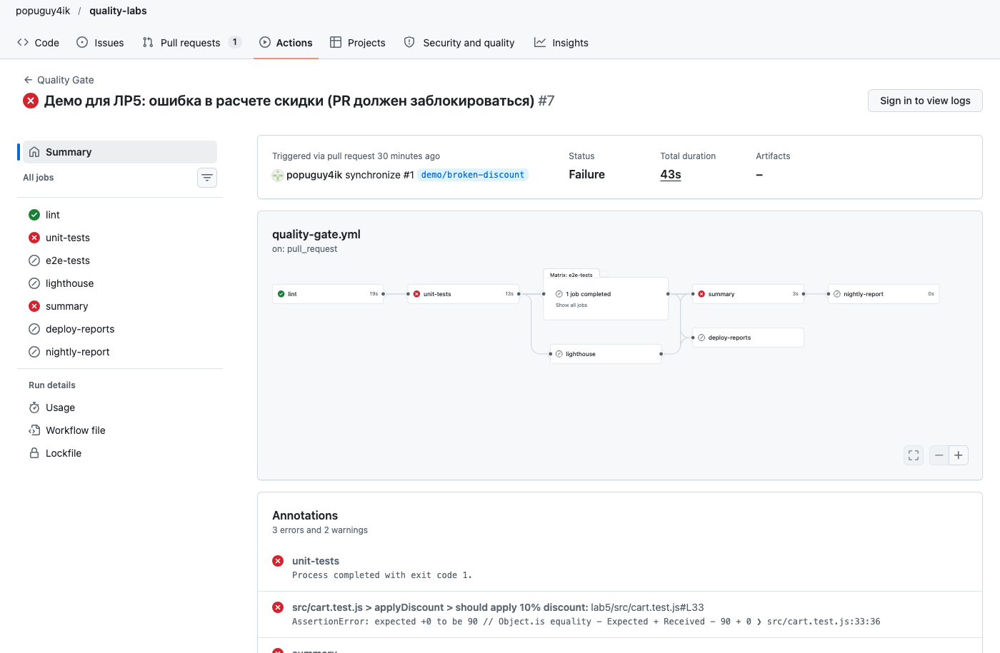

# 1 Цель работы

1. Освоить GitHub Actions для автоматизации тестирования.
2. Научиться объединять юнит-тесты, E2E-тесты и аудит в единый пайплайн.
3. Изучить принципы quality gates и защиты веток.
4. Получить практические навыки настройки matrix-стратегии.
5. Понять принципы непрерывного контроля качества.

# 2 Ход работы

## 2.1 Проект и пайплайн

Пайплайн объединяет результаты предыдущих работ в один проект `lab5`:

- модули корзины, форматирования и проверки почты с 35 юнит-тестами из лабораторной работы 1;
- сайт «Сова» (папка `site`), который собирается в `dist`;
- E2E-тесты сайта на Playwright (6 сценариев) и визуальные скриншот-тесты (3 страницы);
- конфигурация Lighthouse CI с бюджетом производительности из лабораторной работы 3.

```text
lab5
├── src/                    модули и юнит-тесты (Vitest)
├── site/                   сайт «Сова»
├── e2e/site.spec.ts        E2E-сценарии сайта
├── e2e/visual.spec.ts      визуальные тесты
├── playwright.config.ts    3 браузера, сервер dist на порту 3000
├── lighthouserc.json       проверки Lighthouse и бюджет
├── vitest.config.js        пороги покрытия 80 %
└── build.mjs               сборка сайта в dist
```

Пайплайн описан в `.github/workflows/quality-gate.yml` (листинг @lst:gate). Он запускается на push в ветки `main` и `develop`, на Pull Request в `main`, по расписанию и вручную. Этапы связаны через `needs`: сначала статический анализ, потом юнит-тесты, после них параллельно E2E и Lighthouse, в конце сводный отчет.

Листинг: {#gate} Структура .github/workflows/quality-gate.yml (сокращено)

```yaml
name: Quality Gate
on:
  push: { branches: [main, develop] }
  pull_request: { branches: [main] }
  schedule:
    - cron: '0 6 * * *'
  workflow_dispatch:
defaults:
  run: { working-directory: lab5 }
jobs:
  lint:          # npm run lint и prettier --check
  unit-tests:    # needs: lint;        npm run test:coverage, артефакт coverage
  e2e-tests:     # needs: unit-tests;  matrix: [chromium, firefox, webkit]
    strategy:
      fail-fast: false
      matrix:
        browser: [chromium, firefox, webkit]
    steps:
      - run: npx playwright install --with-deps ${{ matrix.browser }}
      - run: npx playwright test --project=${{ matrix.browser }}
  lighthouse:    # needs: unit-tests;  npm run build и npx lhci autorun
  summary:       # needs: все этапы;   if: always(), падает, если хоть один этап не success
  deploy-reports:  # публикация отчетов на GitHub Pages
  nightly-report:  # только для запуска по расписанию: создает Issue с итогом
```

По сравнению с шаблоном из задания изменено следующее:

- Node.js 22 вместо 20 (текущая LTS) и кеш npm по `lab5/package-lock.json`, так как в репозитории несколько проектов;
- `fail-fast: false` в матрице: если E2E упадут в одном браузере, остальные доработают, и в отчете будет видно, где именно проблема;
- в `summary` учитывается и Lighthouse, а итог выводится таблицей в `GITHUB_STEP_SUMMARY`, то есть прямо на странице запуска;
- сервер для E2E поднимает сам Playwright (`webServer` в конфигурации), поэтому шаг `npx serve -s dist -l 3000 &` не нужен.

## 2.2 Локальная проверка этапов

Перед публикацией каждый этап пайплайна прогнан локально теми же командами (таблица @tbl:local).

Таблица: {#local} Результаты этапов при локальном запуске

| Этап | Команда | Результат |
|---|---|---|
| lint | `npm run lint`, `npm run format:check` | 0 проблем, все файлы отформатированы |
| unit-tests | `npm run test:coverage` | 35 из 35, покрытие строк и ветвей 100 % |
| e2e-tests | `npx playwright test` (без визуальных) | 18 из 18: 6 сценариев × 3 браузера |
| lighthouse | `npm run build && npx lhci autorun` | 3 страницы × 3 прогона, все проверки и бюджет пройдены |

Локальный прогон нашел ошибку конфигурации, которая уронила бы CI. Vitest по умолчанию ищет тесты по всему проекту и подхватывал файлы Playwright из `e2e/`. Юнит-тесты при этом проходили, но команда завершалась с ошибкой из-за двух «упавших» файлов. Исправлено параметром `include: ['src/**/*.test.js']` в `vitest.config.js`.

E2E-сценарии сайта приведены в таблице @tbl:e2e.

Таблица: {#e2e} E2E-тесты сайта «Сова»

| № | Сценарий | Проверки |
|---|---|---|
| 1 | Навигация | Заголовок первого экрана, переход в «Возможности», `aria-current="page"` у активного пункта |
| 2 | Темная тема | Переключатель меняет `data-theme`, `aria-pressed`, выбор сохраняется после перезагрузки |
| 3 | Мобильное меню | На ширине 375 px меню открывается, `aria-expanded="true"`, закрывается по Esc, фокус возвращается на кнопку |
| 4 | Форма контактов | Пустая отправка показывает ошибки и ставит фокус на первое поле, заполненная показывает подтверждение |
| 5 | Блог | 6 статей на первой странице, переход на вторую (3 статьи), хлебные крошки |
| 6 | Карточка возможности | Переход на детальную страницу, заголовок и хлебные крошки |

## 2.3 Защита ветки

Защита ветки `main` настраивается в GitHub: Settings → Branches → Add rule, шаблон `main`, включены «Require status checks to pass before merging» и «Require branches to be up to date», обязательные проверки `lint`, `unit-tests`, `e2e-tests` и `lighthouse`. После этого кнопка слияния Pull Request недоступна, пока все проверки не пройдут.

%%CI_PROTECTION%%

## 2.4 Публикация отчетов и бейджи

Задача `deploy-reports` скачивает артефакты всех этапов (отчет о покрытии, HTML-отчеты Playwright по браузерам, отчеты Lighthouse) и публикует их в ветку `gh-pages` действием `peaceiris/actions-gh-pages`. Дополнительно она создает главную страницу со ссылками на отчеты и файл `coverage-badge.json`.

Вместо Codecov процент покрытия публикуется на тех же GitHub Pages: файл `coverage-badge.json` в формате shields.io читается сервисом бейджей. Так не нужен сторонний сервис и токен `CODECOV_TOKEN`. В `README.md` добавлены два бейджа:

```markdown


```

Отчеты опубликованы по адресу https://popuguy4ik.github.io/quality-labs/: на главной странице ссылки на отчет о покрытии, отчет Lighthouse и HTML-отчеты Playwright для каждого браузера. Бейджи в README показывают статус пайплайна и процент покрытия (рисунок @fig:readme).

{#readme width=13cm}

# 3 Задания для самостоятельного выполнения

## 3.1 Задание 1. Блокировка PR при падении этапа

**Текст задания.** Настройте пайплайн с юнит-тестами и E2E-тестами. Убедитесь, что при падении любого этапа PR блокируется.

Пайплайн с юнит- и E2E-тестами настроен в разделе 2.1. Запуск на ветке `main` прошел полностью: все 7 задач, включая E2E в трех браузерах и визуальные тесты, Lighthouse, публикацию отчетов и сводку, выполнены успешно за 2 минуты 38 секунд (рисунок @fig:main).

{#main width=16.5cm}

Чтобы проверить блокировку, я создал ветку `demo/broken-discount` с намеренной ошибкой: в функции `applyDiscount` деление на 100 заменено делением на 10. Из нее открыт Pull Request №1 в `main`. Пайплайн упал на этапе `unit-tests`: тест «should apply 10% discount» ожидал 90, а получил 0 (рисунок @fig:pr). Этапы E2E и Lighthouse после этого не запускались, потому что зависят от юнит-тестов (`needs`), а сводка `summary` завершилась с ошибкой.

{#pr width=16.5cm}

%%USER_SHOTS%%

Так проверяется главное свойство quality gate: изменение с ошибкой не может попасть в основную ветку, даже если автор забыл запустить тесты локально. Демонстрационный PR не сливался.

## 3.2 Задание 2. Визуальное регрессионное тестирование

**Текст задания.** Добавьте визуальное регрессионное тестирование через Chromatic или Playwright screenshot-тесты.

Выбраны screenshot-тесты Playwright: они не требуют стороннего сервиса и работают в том же пайплайне. Тест открывает страницу и сравнивает снимок первого экрана с эталоном через `toHaveScreenshot` (листинг @lst:visual). Допускается отличие не более 1 % пикселей. Анимации отключаются, а карта OpenStreetMap на странице контактов блокируется, потому что ее тайлы каждый раз загружаются по-разному.

Листинг: {#visual} Визуальные тесты (e2e/visual.spec.ts)

```typescript
test.describe('Визуальные тесты', () => {
  test.use({ viewport: { width: 1280, height: 800 } });

  for (const [name, path] of [['home', '/'], ['features', '/features.html'], ['contacts', '/contacts.html']]) {
    test(`первый экран: ${name}`, async ({ page }) => {
      await page.emulateMedia({ colorScheme: 'light', reducedMotion: 'reduce' });
      await page.route('**/openstreetmap.org/**', (r) => r.abort());
      await page.goto(path);
      await page.evaluate(() => document.fonts.ready);
      await expect(page).toHaveScreenshot(`${name}.png`);
    });
  }
});
```

Важная деталь: эталонные скриншоты зависят от операционной системы, потому что шрифты сглаживаются по-разному в macOS и Linux. Эталоны, снятые на моем компьютере, в CI на Ubuntu не совпадут, и тесты будут падать не из-за верстки. Поэтому эталоны снимает отдельный workflow `update-screenshots.yml` (запуск вручную) на той же Ubuntu, что и пайплайн, и коммитит их в репозиторий. В конфигурации путь к эталонам не содержит имени ОС (`snapshotPathTemplate`), а визуальные тесты запускаются только в Chromium.

Workflow `update-screenshots.yml` запускается автоматически при изменении файла визуальных тестов. Он снял три эталона на Ubuntu и закоммитил их от имени `github-actions[bot]`. После этого визуальные тесты в пайплайне проходят (рисунок @fig:main, задача e2e-tests (chromium)). Если изменение верстки сдвинет блоки на первом экране, тест упадет, а в HTML-отчете Playwright будут три картинки: эталон, текущий снимок и разница между ними.

## 3.3 Задание 3. Nightly build

**Текст задания.** Реализуйте nightly build: запуск полного пайплайна по расписанию (cron) с отправкой отчета на email.

Запуск по расписанию задан строкой `cron: '0 6 * * *'`, то есть каждый день в 6:00 UTC (11:00 по Екатеринбургу). Для отправки отчета используется задача `nightly-report`, которая выполняется только при запуске по расписанию (листинг @lst:nightly). Она создает в репозитории Issue с итогом quality gate и ссылками на запуск и отчеты. GitHub присылает уведомление о новом Issue на почту владельцу репозитория, поэтому отчет приходит на email без настройки SMTP-сервера и хранения пароля почты в секретах.

Листинг: {#nightly} Задача nightly-report

```yaml
nightly-report:
  runs-on: ubuntu-latest
  needs: [summary]
  if: always() && github.event_name == 'schedule'
  steps:
    - uses: actions/github-script@v7
      with:
        script: |
          const r = '${{ needs.summary.result }}';
          const url = `${context.serverUrl}/${context.repo.owner}/${context.repo.repo}/actions/runs/${context.runId}`;
          await github.rest.issues.create({
            owner: context.repo.owner, repo: context.repo.repo,
            title: `Nightly build ${new Date().toISOString().slice(0, 10)}: ${r === 'success' ? 'успех' : 'ошибка'}`,
            body: `Результат quality gate: **${r}**\n\nЗапуск: ${url}\nОтчеты: https://${context.repo.owner}.github.io/${context.repo.repo}/`,
          });
```

Условие `if: always()` нужно, чтобы отчет пришел и при неудачной ночной сборке: именно такие письма самые важные.

Пайплайн с расписанием уже работает в репозитории: первый ночной запуск произойдет в 6:00 UTC, и в разделе Issues появится отчет. Запуск можно проверить и вручную кнопкой Run workflow (`workflow_dispatch`), но задача `nightly-report` срабатывает только для события `schedule`, чтобы не создавать Issue при каждом ручном запуске.

# 4 Вывод

В работе собран пайплайн Quality Gate, который объединяет все инструменты из предыдущих работ: статический анализ, юнит-тесты с порогом покрытия, E2E-тесты в трех браузерах через matrix-стратегию, визуальные тесты и аудит Lighthouse с бюджетом производительности. Этапы выполняются в правильном порядке: дешевые и быстрые проверки идут первыми, а дорогие E2E и Lighthouse запускаются только после них и параллельно друг другу.

Quality gate вместе с защитой ветки делает проверки обязательными: изменение, которое ломает тесты, нельзя слить в `main`. Отчеты публикуются на GitHub Pages, состояние видно по бейджам в README, а ночная сборка ловит проблемы, которые возникают без изменений в коде, например в чужих зависимостях или на внешних сервисах.

Уже на этапе подготовки пайплайн оправдал себя: локальный прогон тех же этапов нашел ошибку в конфигурации Vitest, которая уронила бы первый запуск в CI.
